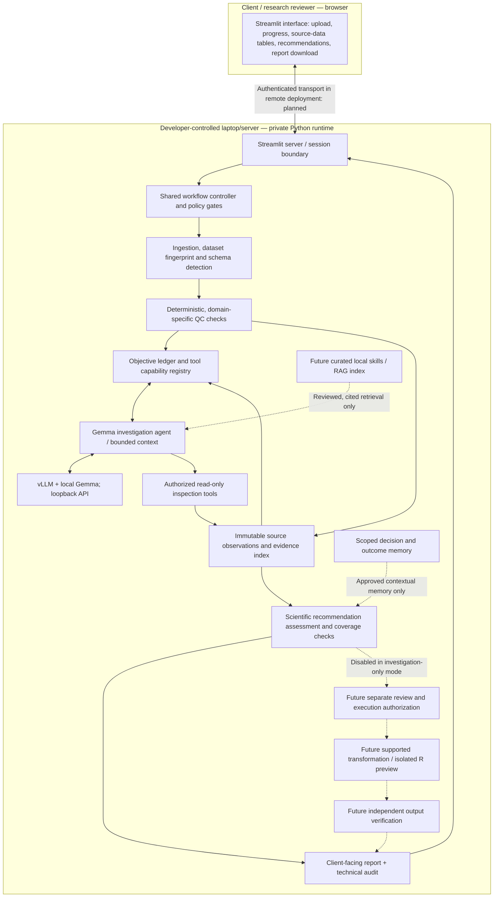
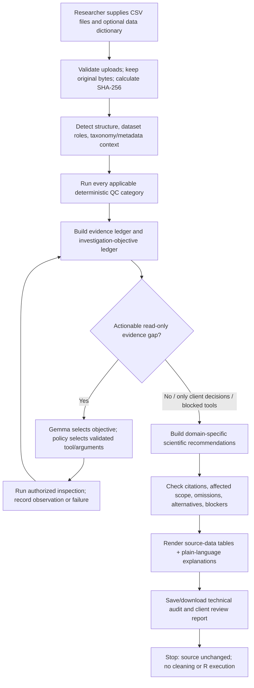
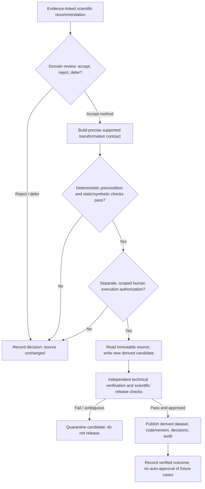

# Healthcare Data Quality LLM

**Local-first, evidence-grounded, human-governed quality control and remediation for scientific and biomedical tabular data.**

> **Current design and operating contract — 22 November 2026.** This section consolidates the latest review, scheduling, memory, user-interface, and export designs. The later **Historical engineering reference** records earlier CLI and research prototypes; its old UI and approval descriptions are not current requirements. This README revision is based on the supplied README and PyCharm/Streamlit screenshots, **not a source-code audit or a new end-to-end test**. Features should be regarded as implemented only after their corresponding integration tests and live model/UI tests pass. The application remains a research prototype, not a clinically validated system or a HIPAA compliance guarantee.

## 1. Architecture: evidence → model deliberation → authorization → verification

The system uses **three asynchronous logical agents sharing one locally hosted Gemma model** through a vLLM-compatible inference endpoint. Deterministic Python services, not model text, control source facts, permissions, modifications, and final acceptance. A single model process does not imply three dedicated GPUs or guaranteed simultaneous completions.

| Agent | Operational responsibility | Authority boundary |
| --- | --- | --- |
| **A — Investigation** | Dataset profiling, deterministic QC, read-only exploratory hypotheses, evidence and coverage tracking | May inspect authorized data; cannot alter it |
| **B — Recommendation synthesis** | Source-aware retrieval, alternative cleaning strategies, Gemma assessment/critique, actionable Before → After proposals | May recommend; cannot authorize execution |
| **C — Interactive review** | Respond to reviewer instructions, incorporate dialogue context, formulate/refine competing proposals, resolve ambiguity, and record decisions | Executes only an explicitly selected, validated action; may assist B on a different finding when idle |

**Trust boundary.** Source bytes and fingerprints, immutable original coordinates, evidence registry, reviewed intent, staged changes, exported output, and an append-only decision history are separate artifacts. Model suggestions and retrieved memory are *untrusted advisory inputs*. They cannot override scope, invent source values, silently mutate the original, or confer reviewer authorization. The default CLI investigation remains read-only; the reviewer-controlled Streamlit cleaning path is a distinct mode.

### 1.1 Multi-agent scheduling and workload balancing

- **Concurrency:** `HDQ_LLM_MAX_ACTIVE=3` governs admitted model requests in the application; `HDQ_MAX_NUM_SEQS=3` is the intended vLLM scheduling limit. These are separate constraints. Use a single model endpoint, with bounded queues, deadlines, cancellation, and per-role telemetry.
- **Finding-level ownership:** The scheduler should allocate work by `(source_hash, investigation_id, finding_id, revision)`. Agent B and an idle Agent C must **not synthesize the same finding/revision simultaneously**. A claim/lease, idempotency key, and stale-result rejection prevent duplicate cards, duplicate edits, or late writes. Any source or reviewer change invalidates the old revision.
- **Work conservation:** Agent C gives **interactive reviewer requests preemptive priority**. When no interactive work is pending, its spare lane can assist B with a **different unclaimed finding**; an idle A lane may also assist if investigation work permits. B retains responsibility for proposal ownership and published readiness. Work stealing does not authorize execution or increase the three-request limit.
- **Incremental results:** Publish each independently verified finding as soon as it is ready, with statuses `queued`, `model-reviewing`, `validating`, `ready`, `needs-retry`, `superseded`, or `resolved`. Failures must show an actionable reason and offer bounded retry; they must not silently disappear or repeatedly regenerate successful results.
- **Progress visibility:** Show a small running/jogging indicator **before each waiting finding/check label**, plus the role, current phase, completed/total counts, and elapsed time where available. Keep progress polling isolated from editable Streamlit fragments to prevent flashing, focus loss, or scroll jumps. A running animation signals activity, **not verified success**.

### 1.2 Deliberative planning, reflection, and learning

Recommendation generation follows **retrieval-augmented case-based reasoning** and a **generate → critique → verify → present** pipeline:

1. **Ground:** Fetch original source evidence, complete affected scope, schema conventions, adjacent normal examples, past user decisions, and relevant generated skills. Explicitly distinguish source facts from context or inference.
2. **Generate:** Ask Gemma for feasible alternatives, including compound row/column operations, replacements, rounding, missing-value handling, unchanged/ignore choices, and non-destructive visual annotations. One finding may legitimately have several valid strategies.
3. **Reflect / self-critique:** Have Gemma assess consistency with the dataset's dominant pattern, reviewer intent, prior interactions, scientific plausibility, potential side effects, and overlap with other findings. The model should reason about indirect patterns (e.g., a user's earlier `0.2 → 2` and `0.5 → 5` decisions), but **must not infer an executable multiply-by-ten rule without current evidence and approval**.
4. **Verify deterministically:** Validate typed operations, exact one-based original CSV positions, source `before` values, target coverage, no unapproved mutations, and interaction-specific scope. Reject unsupported, stale, contradictory, or ungrounded plans. Where model review is required, **do not show actionable buttons until both model assessment and deterministic validation complete**.
5. **Learn from outcomes:** Record reviewer-approved, declined, no-change, superseded, and failed cases with provenance. Feed relevant error patterns and counterexamples back into later prompts and tests. This is **inference-time reflection and memory-based adaptation**, *not* autonomous model weight updates, automatic code repair, or evidence of self-improvement without evaluation.

**Memory provenance:** Same-source/same-finding methods may be reused only after current evidence and scope revalidation. Cross-source, cross-finding, or generated `skills/` advice requires fresh Gemma applicability assessment and independent checks. Report *which* earlier decision influenced an option, how it was adapted, and why it remains applicable. Source data, reviewer logs, and local generated memories should remain outside Git.

## 2. Reviewer journey and human–AI interaction

1. **Intake:** Upload the dataset and collect the named **reviewer identifier before initiating investigation or cleaning**. Bind review state to the exact source fingerprint; never overwrite original uploads.
2. **Investigate:** Agent A exposes evidence and checks; B/C synthesize independently scheduled, case-aware recommendations. The **Clean data with LM model** page remains visible and primary. **Manage skills & memory**, **Data quality findings**, and **Supporting evidence** are smaller secondary navigation controls on the right.
3. **Reveal progressively:** A finding's title/count and waiting indicator appear immediately. Lock **only that finding's expandable review/actions** while its verified recommendation is pending; never lock the entire cleaning page. Auto-expand actionable findings as verified options arrive, without destabilizing the active review.
4. **Present an actionable choice:** Every final action has an explicit verb, source scope, short rationale, and exact **Location | Before | After** (or an expandable complete bulk table). Use green for actionable choices, red for **No — Discuss Another Idea**. Never use ambiguous `Approve & Execute` text without stating the exact operation.
5. **One-click informed authorization:** The **single click on a green, already source-verified option** is the reviewer's authorization **and** stages/executes the specified action on the derived working copy atomically. **Do not show a second “Yes — Approve & Execute” for the same choice.** A chat message, model recommendation, or scope-clarifying button is not authorization; if the complete Before → After is not yet available, first prepare it and only then expose the executable choice. Require distinct authorization again for any materially changed proposal.
6. **Discuss without friction:** `No — Discuss Another Idea` opens the current finding's Agent C discussion and **focuses the message box immediately**, without sending a premature model request. Support Enter-to-send where configured. Subsequent options must incorporate the **entire conversation**, not only the latest sentence, and be checked against original data before rendering.
7. **Complete accurately:** `Keep as is` / `Mark reviewed (no change)` is a valid terminal review decision, including an intentionally blank taxonomy header. `Mark reviewed — resolved by earlier approvals` is valid only after complete lineage reconciliation. Close/collapse **only** that resolved finding, keep its green header in place, and retain a reopenable audit view.
8. **Release:** Enable the selected downloadable artifact only when its scope, authorization, data, styling, and audit invariants pass independent verification. If a *complete review package* is requested, block release until required review items are terminal and explain every blocker clearly.

**Human-factors contract:** Minimize repetitive text entry. Maintain consistent single-purpose buttons across baseline QC findings and exploratory Gemma checks; prevent duplicate controls and repeated model messages. Keep navigation, focus, scroll position, and card identity stable across independent background updates. For large findings, summarize total affected items and offer the full verification table on demand.

## 3. Cross-finding causality, reconciliation, and transaction semantics

A finding may overlap with previously approved row deletions, column deletions, cell replacements, or annotations. **The original CSV's physical coordinates are the immutable reference frame**; mapping to surviving final coordinates is derived after applying authorized operations. The application must never silently reinterpret shifted row/column numbers as original positions.

- **Scope resolution:** Compute candidate effects against the original source, current approved operation ledger, and the latest reviewer intent. A request such as `delete columns 7 and 11` is **one compound operation** on *both original columns*, not two competing partial choices. Row deletion and merging must likewise use source-verified identities and explicit aggregation semantics.
- **Conflict analysis:** Detect overlapping or mutually exclusive actions before presentation and before commit. A deleted row/column **supersedes** earlier edits or highlights within it; these remain in history but must not reappear in the final dataset or be counted as surviving changes.
- **No double application:** A previously executed cleaning method may resolve another finding without any new mutation. Show the earlier action ID and exact original → final evidence. If *all* targets are resolved, expose a **single close/mark-reviewed option**. If *some* survive, re-plan only the live remainder; never claim the entire finding has been fixed.
- **Correct sequencing:** Later approvals must be checked against the staged state and dependency graph. Reopening/reversing an earlier approval requires conflict-aware rollback/replay or an explicitly blocked explanation with dependent action IDs.
- **Transaction properties:** For a compound reviewer choice, validate the complete batch first, apply all-or-nothing to a derived copy, and record an idempotent event. A repeated UI click, delayed model response, or retry must not duplicate the operation. A failed validation must leave the staged dataset unchanged.

**Illustrative failure:** If row 7 has already been deleted, Agent C must not claim the row was “standardized” solely because a stale proposal says so. The accurate outcome is “target removed by approved deletion,” with the deletion's audit record, and closure permitted only if the finding has no remaining unresolved scope.

## 4. Verified export and reviewer-oriented provenance

The primary deliverable is a **complete review package (`.zip`)** containing the **original CSV**, **cleaned CSV**, and **review workbook (`.xlsx`)**; deliver standalone CSV/XLSX only when that release mode is selected and validated. The workbook provides four reviewable sheets:

| Sheet | Required evidence for a human reviewer |
| --- | --- |
| **Cleaned dataset** | Final surviving values, original order/labels where applicable, and approved red/bold/highlight annotations. **CSV cannot store font colors or fills**. |
| **Audit trail** | Group by finding/check, not one unexplained flat operation list: reviewer, decision, timestamp, exact original row/column, before/after, operation scope, status, supersession/dependency and final location or deletion. |
| **Interaction log** | Concise, chronological, attributable reviewer–Agent C dialogue and consequential proposed/approved actions; omit duplicated assistant boilerplate without losing decision context. |
| **Verification** | Source and final SHA-256; schema and row/column counts; complete approved-operation inventory; **every original → approved → final outcome**, survivor mapping, suppressed annotations, independent comparison results, and any unresolved exceptions. |

**Independent release gate:** Reconstruct the final CSV from the original bytes plus **only** accepted actions and compare it with the delivered CSV/XLSX. Check all surviving cells, header decisions (including intentionally blank), row/column remapping, visual flags on surviving locations, counts, approval scope, and review/interaction ledger completeness. Verify the XLSX is readable and that no unintended edits occurred; fail closed with a specific discrepancy if not. A SHA-256 and a “verified” label alone do **not** prove semantic or clinical correctness.

**Scientific data policy:** In seven-rank taxonomy strings, `NA` counts as a rank and can appear in any position. Missing count cells are distinct from taxonomy `NA`. The model must not fabricate biological identities or generalize a sample into a whole-dataset count. Formatting changes (separators, prefixes) and taxonomic substitutions are different classes of operation, each requiring an explicit, inspectable outcome.

## 5. Implementation map and regression strategy

The following are **module responsibilities inferred from the supplied file tree and design notes**; file presence does not establish that every path is wired into the live application.

| Concern | Relevant source modules / tests |
| --- | --- |
| Source-aware planning and review | `services/model_plan_review.py`, `services/recommendation_options.py`, `services/source_patterns.py`; `tests/test_cross_finding_gemma_review_gate_20261122.py` |
| Reviewer choice semantics and UI | `ui/one_click_choice.py`, `ui/finding_choice_integrity.py`, `ui/clear_review_actions.py`, `ui/review_input_focus.py`, `ui/single_selection_flow.py`; `tests/test_one_click_all_finding_types_and_runners.py` |
| Reconciliation and authorized changes | `cleaning/previous_approval_resolution.py`, `cleaning/proposal_conflicts.py`, `cleaning/review_reconciliation.py`, `cleaning/compound_approval.py`; `tests/test_prior_approval_resolution_review_20261123.py` |
| Memory and failure feedback | `learning/model_failure_patterns.py`, `ui/recommendation_memory_trace.py`, `ui/recommendation_failure_recovery.py`; `tests/test_model_review_feedback_and_retry_20261122.py` |
| Background readiness and scheduling | `jobs/cleaning_jobs.py`, `ui/finding_wait_gate.py`, `ui/running_indicator.py`, `ui/recommendation_wait.py`; `tests/test_agent_c_idle_assists_agent_b_20261123.py`, `tests/test_waiting_jogger_before_title_20261123.py` |
| Export integrity and audit | `cleaning/final_export_integrity.py`, `cleaning/reviewer_audit_workbook.py`, `cleaning/review_zip_bundle.py`, `cleaning/one_click_visual_flag.py`; `tests/test_full_review_scope_audit_verification_20261122.py` |

Full module paths above are relative to `src/healthcare_data_quality/`. Main Streamlit entry point: `app.py`. **All new imported modules and tests under `Unversioned Files` must be added to version control**, not just the modified files displayed above them.

### 5.1 Acceptance and adversarial regression matrix

A passing unit suite is necessary but insufficient. Exercise the following *across every finding/check category*, with both default recommendations and free-text Agent C requests:

| Scenario | Required invariant |
| --- | --- |
| Same-finding B/C concurrency; delayed completions | At most one owner for each finding/revision; stale response discarded; no duplicate cards or operations |
| Previously approved deletion vs. later formatting/replacement | Correct supersession; survivor-only proposals; accurate mark-reviewed closure |
| Partial overlap across multiple findings | Only unresolved targets receive new proposals; no unintended extra edits |
| Multi-target request (`delete 7 and 11`) | Atomic full batch, clear Before → After, one click, no silent narrowing or expanding |
| Reviewer changes direction during discussion | Latest intent and complete prior context respected; stale buttons invalidated |
| Keep header blank / no change | Terminal reviewed state; unchanged header preserved; export remains eligible |
| Negative/fractional/missing counts; taxonomy/separator/prefix combinations | Action matches source conditions; unrelated cells unchanged; scientific assumptions not invented |
| Visual flag followed by deletion | No orphaned style; audit records supersession; surviving styles in XLSX verified |
| Gemma timeout, malformed JSON, model review rejection | Specific failure reason, bounded retry, no fabricated fallback approval; other findings unaffected |
| UI rerender and download | No focus/scroll flash, no duplicate buttons; independent reconstructed output matches artifacts |

Run from the repository root in the project environment:

```bash
# Confirm the intended source-tree import path and current branch.
git branch --show-current
PYTHONPATH=src:scripts python -m compileall -q app.py src/healthcare_data_quality

# Use the complete suite: new tests must be collected, not just selected older tests.
PYTHONPATH=src:scripts python -m pytest -q --tb=short

# Focused cross-finding, concurrency, review, and export contracts.
PYTHONPATH=src:scripts python -m pytest -q \
  tests/test_cross_finding_gemma_review_gate_20261122.py \
  tests/test_model_review_feedback_and_retry_20261122.py \
  tests/test_prior_approval_resolution_review_20261123.py \
  tests/test_agent_c_idle_assists_agent_b_20261123.py \
  tests/test_full_review_scope_audit_verification_20261122.py \
  --tb=short
```

**Do not publish a pass count until it is observed on the *current* code revision.** The maintainer previously reported **478 passing tests** before some of the newest patches; that count must not be presented as evidence for the latest changes. Also perform a live Streamlit/Gemma smoke test and replay a source CSV plus a non-confidential synthetic fixture. Test for import errors, hidden regressions, real output correctness, conflict handling, and UI responsiveness; do not treat LLM self-assessment as independent validation.

## 6. Local development, security, and Git delivery

### 6.1 Start the shared model and Streamlit application (existing WSL configuration)

**Terminal A — model server (leave running):**

```bash
cd /mnt/c/Users/Xavier/PycharmProjects/healthcare-data-quality-llm
source /home/xavier/.venv/bin/activate
bash scripts/serve_gemma4.sh
```

**Terminal B — Streamlit UI (open a separate terminal):**

```bash
cd /mnt/c/Users/Xavier/PycharmProjects/healthcare-data-quality-llm
source /home/xavier/.venv/bin/activate
PYTHONPATH=src:scripts streamlit run app.py \
  --server.address 127.0.0.1 --server.port 8501 \
  --browser.gatherUsageStats false
```

Verify `curl -fsS http://127.0.0.1:8000/v1/models` and open `http://127.0.0.1:8501`. These are the developer's documented WSL paths, **not a universal or newly verified setup**. The Alienware RTX 5080 native-Windows deployment must use its own tested launcher; do not assume a WSL `.sh` vLLM launch works in PowerShell. Rebenchmark model throughput and memory on that device.

### 6.2 Commit on `backend` in PyCharm, then push

1. Copy this updated document into the project's **root `README.md`**; verify that the Git branch indicator shows **`backend`**. Preserve uncommitted working files.
2. In PyCharm's **Commit** tool window (`Alt+0`), select reviewed tracked changes **and** the required source/test files under **Unversioned Files**. Inspect every new `src/healthcare_data_quality/**.py` dependency and relevant `tests/test_*.py` file. Include `pytest.ini` if necessary for the tested import path.
3. **Do not indiscriminately select all unversioned files.** Temporary `tools/apply_*.py` patch installers, `.bak` launchers, scratch ZIPs, local model/data/memory files, and secrets are normally excluded unless they are intentional, reviewed project deliverables. Inspect special cases such as `tools/assets/reviewer_audit_fallback.py` for actual runtime imports before deciding.
4. Run the full tests above, review selected diffs and test files, and check `git status --short` / `git diff --check` in the terminal. Use a coherent commit message, e.g., `feat: reconcile multi-agent reviews and strengthen audit integrity`.
5. Click **Commit and Push…**, review the destination (normally `origin/backend`) and outgoing file list, and confirm **Push**. Alternatively, click **Commit** and later use **Git → Push** (`Ctrl+Shift+K`). Never force-push to resolve a rejection; fetch/integrate remote changes after review.
6. After push, confirm a clean intended working tree and the new commit in **Git → Log**. Only merge `backend` into `main` after successful Streamlit integration tests and source-level conflict review.

**Public-repository review:** The historical appendix retains a maintainer email address and machine-specific Windows/WSL paths. Check that you intend to publish those details before pushing to a public remote.

**Privacy and reproducibility:** Keep healthcare/customer datasets, derived CSV/XLSX/ZIP packages, `memory/`, `skills/generated/`, `models/`, `.venv/`, caches, raw conversations, credentials, and local logs out of commits. Preserve prompt/model version, validation implementation version, source fingerprint, and reviewer decision lineage to support reproducibility. Local inference alone does not satisfy regulatory security requirements.

---

## Historical benchmark: Gemma 4 12B inference optimization (21 November 2026)

> The measurements below are a **historical RTX 3080/WSL2 experiment** retained for reproducibility. They do not establish throughput or compatibility for the current RTX 5080 deployment, and launcher flags must be checked against the current script.


**Measured 2026-11-21 on an NVIDIA GeForce RTX 3080 Laptop GPU (16 GiB) using WSL2 and vLLM 0.33.0.** This is a hardware-specific development benchmark, not an established optimum for the intended Alienware **RTX 5080 Laptop GPU (16 GB)**. Rebenchmark on the RTX 5080 rather than transferring the timing or FP8 compatibility conclusions.

The tested Gemma checkpoint was loaded through vLLM's `compressed-tensors` quantization path. The **one local model** serves all three logical agent roles. Preserve the application request cap `HDQ_LLM_MAX_ACTIVE=3`, server concurrency **`--max-num-seqs 3`**, and minimum context **`--max-model-len 12288`**.

**Tested server flags** (the final portion of `scripts/serve_gemma4.sh`):

```bash
    --max-model-len "$MODEL_LEN" \
    --gpu-memory-utilization 0.90 \
    --max-num-seqs 3 \
    --model-impl vllm \
    --kv-cache-dtype bfloat16 \
    --async-scheduling \
    --language-model-only
```

**Key change: remove `--enforce-eager`.** This allows vLLM to use its compiler and CUDA Graph capture on compatible operations. The actual startup log confirmed `enforce_eager=False`, `CompilationMode.VLLM_COMPILE`, `CUDAGraphMode.FULL_AND_PIECEWISE`, and completed both full and piecewise graph captures. `--model-impl vllm` selects the implementation; it is not intrinsically a speed boost. BF16 KV cache was selected for RTX 3080 compatibility, not because BF16 is always fastest.

**Why CUDA Graphs can improve Gemma throughput:** Autoregressive decoding runs many similar GPU operations for each new token. Under eager execution, the CPU repeatedly issues kernel launches. `torch.compile`/vLLM compilation can optimize compatible computation and fuse eligible kernels; CUDA Graphs capture compatible GPU work and replay the execution sequence with reduced CPU launch overhead. **FULL** captures larger supported paths, whereas **PIECEWISE** covers capturable regions when a whole path is unsuitable. Capturing execution does **not** cache model answers: token values are still newly computed from each prompt and its KV cache. Asynchronous scheduling can separately reduce scheduling gaps. The tradeoffs are startup compilation/capture time and some extra GPU memory use; gains are workload dependent.

**Three-request synthetic benchmark** (`scripts/test_gemma_three_way_concurrency.py --prompt-words 2000 --max-tokens 512`; all three requests returned HTTP 200 and the sampled vLLM running-request peak reached **3**):

| Configuration | Three-request wall time | Measurement notes |
| --- | ---: | --- |
| Eager + async scheduling | 29.79 seconds | One baseline run |
| Eager, async scheduling disabled | 30.88 seconds | One run |
| Compiled + CUDA Graphs + async scheduling | 17.74, 11.97, 11.29 seconds | Three consecutive runs; **median 11.97 seconds** |

The **11.97-second median is approximately 2.49× faster**, or about **60% less wall time**, than the single 29.79-second eager baseline. **Do not claim a causal 2.49× speedup from CUDA Graphs alone:** the optimized runs were warmed up, response token counts differed, and we have not collected equivalent repeated warm eager-mode runs. The test prompts contained approximately **2,031 tokens per request**. Successful three-way concurrency at that size does **not** prove that three near-12,288-token contexts will fit or that all application outputs remain correct.

**Reproduce and verify** (the model server should remain running in Terminal A; use a second WSL terminal):

```bash
cd /mnt/c/Users/Xavier/PycharmProjects/healthcare-data-quality-llm

# Run three simultaneous requests against the existing local vLLM server.
python3 scripts/test_gemma_three_way_concurrency.py \
  --prompt-words 2000 --max-tokens 512

# Observe VRAM and hardware while the benchmark runs.
nvidia-smi
```

To collect compiler/capture evidence, start the server in Terminal A with its logs saved, then inspect the log from another terminal:

```bash
bash scripts/serve_gemma4.sh 2>&1 | tee ~/gemma_server.log
# In a second terminal (after the server starts):
grep -Ei 'enforce_eager|CompilationMode|CUDAGraphMode|Capturing CUDA graphs|Graph capturing finished' \
  ~/gemma_server.log | tail -n 12
```

For a controlled A/B comparison, benchmark **both** eager and compiled configurations with the same GPU, checkpoint, precision, three-sequence limit, 12,288-token context, representative prompt/output settings, warm-up policy, and multiple repetitions. Inspect response completion status, generated-token counts, VRAM, KV-cache preemptions, timeouts, structured JSON validity, and actual A/B/C source-grounded edit proposals. Do not use synthetic completion time as a substitute for application correctness or long-context reliability.

**Hardware and rollback notes:** On the RTX 3080 (compute capability 8.6), `--kv-cache-dtype fp8` failed during initialization because vLLM's selected Triton attention backend required SM89+ for native FP8; `--kv-cache-dtype bfloat16` started successfully. This does not determine FP8 support on the RTX 5080 or with another backend. There is no need to install an extra system-wide CUDA Toolkit or cuDNN merely to enable graph capture in the already-working vLLM environment. If graph compilation/capture fails or causes memory pressure, temporarily restore `--enforce-eager` as a diagnostic rollback, retaining the required **three concurrent sequences** and context.

---

## Historical engineering reference (7–13 November 2026)

> **Archived engineering design, CLI examples, and roadmap.** These older passages intentionally preserve development provenance. Their descriptions of UI readiness, separate approval buttons, source paths, and agent concurrency can predate the 22 November contract above. **Do not use archived statements as current implementation claims.** The source tree and current tests take precedence.

**Local-first, evidence-driven, human-governed data-quality investigation and remediation for healthcare and scientific research.** Earlier project aims included deterministic QC, an agent harness, evidence-backed reports, R-sandbox prototypes, and source-preserving transformation experiments.

## Contents

1. [Objectives and intended users](#objectives-and-intended-users)
2. [Core design principles](#core-design-principles)
3. [Agent harness: current implementation and boundaries](#agent-harness-current-implementation-and-boundaries)
4. [System architecture](#system-architecture)
5. [End-to-end system design and workflow](#end-to-end-system-design-and-workflow)
6. [Current capabilities and limitations](#current-capabilities-and-limitations)
7. [Repository layout](#repository-layout)
8. [Prerequisites and installation](#prerequisites-and-installation)
9. [Start and verify the local LLM](#start-and-verify-the-local-llm)
10. [Quick start: exploratory investigation in the terminal](#quick-start-exploratory-investigation-in-the-terminal)
11. [Complete CLI POC: review, authorize, remediate, verify](#complete-cli-poc-review-authorize-remediate-verify)
12. [Operate the Streamlit application](#operate-the-streamlit-application)
13. [Understanding the investigation results](#understanding-the-investigation-results)
14. [Tools, evidence, and context authorization](#tools-evidence-and-context-authorization)
15. [Human review and execution permissions](#human-review-and-execution-permissions)
16. [Decision memory and verified-outcome memory](#decision-memory-and-verified-outcome-memory)
17. [Working with different dataset types](#working-with-different-dataset-types)
18. [Tests and validation](#tests-and-validation)
19. [Git workflow: one folder, two branches](#git-workflow-one-folder-two-branches)
20. [Data privacy, security, and operational safeguards](#data-privacy-security-and-operational-safeguards)
21. [Troubleshooting](#troubleshooting)
22. [Development roadmap and acceptance criteria](#development-roadmap-and-acceptance-criteria)
23. [Project provenance and maintainer](#project-provenance-and-maintainer)

---

## Objectives and intended users

The system is intended for research analysts, data stewards, bioinformaticians, biomedical informatics teams, and other scientific dataset owners who need reproducible quality-control (QC) decisions, especially when inputs are inconsistent, poorly documented, or semantically ambiguous.

The project's five original objectives remain:

1. **Dirty ID reconciliation:** Find inconsistent or potentially equivalent subject identifiers while distinguishing plausible matches from verified identities.
2. **Duplicate resolution:** Detect repeated subjects, duplicate observations, duplicate variables, and conflicting measurements without automatically discarding records.
3. **Metadata harmonization:** Investigate inconsistent category labels, missing-value encodings, column types, and associated scientific meaning.
4. **Multi-dataset matching:** Support accurate linking of measurements and metadata, including research workflows involving brain-volume or microbiome data.
5. **LLM-assisted cleaning:** Interpret QC evidence, recommend safe changes, obtain informed human approval, and ultimately support reviewed, reproducible Python/R transformations.

**Do not confuse project objectives with implemented features.** The current end-to-end *executed* transformation is a narrowly specified, human-authorized duplicate-column removal on a derived copy. Generalized metadata harmonization, automatic record merging, and generation/execution of R cleaning scripts are future deliverables.

### What a completed customer workflow should look like

1. Upload one or more approved datasets and, where available, a data dictionary or source documentation.
2. Automatically profile and investigate all **applicable** quality categories.
3. Show verified findings with precise targets, record/column references, supporting evidence, and explicit uncertainties.
4. Continue gathering evidence with authorized read-only tools. Ask the user for domain clarification only when the system cannot establish the answer.
5. Propose exact, previewable operations; distinguish **investigation** from **data change**.
6. Let the user accept, reject, or defer a proposal; separately authorize each supported data-changing operation.
7. Write a new derived dataset without overwriting the original; independently verify retained values and write an audit record.
8. Preserve decision and outcome history to inform future investigations without silently granting future permissions.

Steps 2, 4, 6, and 7 are **only partially connected in the current UI**; use the CLI instructions below for the working authorization/remediation POC.

## Core design principles

- **Local-first inference:** The LLM is served locally. The application does not require a hosted LLM API for inference.
- **Deterministic facts first:** Python tools count, compare, validate, and fingerprint; the LLM interprets and prioritizes evidence rather than pretending to perform exact arithmetic.
- **Evidence before conclusions:** A claim cites actual observations, such as `T2.O1`, and should not exceed what those observations establish.
- **Science-aware uncertainty:** Identical values or equal-looking IDs do not establish equivalent scientific meaning.
- **Source-data preservation by default:** The default `run_workflow.py` controller selects registered non-executing objectives only and checks source hashes; it does not execute generated R or write cleaned datasets. The separate older `run_investigation.py` and explicit remediation pathways have different privileges. Reports, memory, and audit artifacts are permitted outputs, not source-data modifications.
- **Separate human gates:** Accepting an investigation recommendation is **not** the same as authorizing its execution.
- **Narrow, scoped execution:** Authorization binds the source fingerprint, target columns, operation, and output path. A derived copy is created rather than editing the source.
- **Independent post-change verification:** Reinspect the output and verify that all retained cells remain unchanged.
- **Append-only provenance of decisions:** Human reviews, execution authorizations, remediation runs, and verified outcomes are recorded separately.
- **One backend, two interfaces:** The CLI and Streamlit call the same Python domain modules. They are **not** independent implementations of the cleaning rules.
- **Untrusted input:** Data values and source-document text must not be treated as instructions that override authorized tool and execution rules.

## Agent harness: current implementation and boundaries

The project already has an **application-specific agent harness**. It is not merely an LLM prompt or a fixed linear ETL script. The harness decides which **permitted investigation objective** to attempt next, delegates the permitted action to deterministic code, preserves its evidence, and tracks whether objectives remain unresolved. The LLM supplies suggestions and interpretations; Python owns tool applicability, arguments and execution permissions.

| Concern | Implementation | Current behavior / boundary |
| --- | --- | --- |
| Entrypoint and stage gating | `scripts/run_workflow.py` | Default CLI runs investigation and reporting only; `--enable-remediation --interactive` explicitly enters a separate legacy path. |
| Workflow orchestration | `src/healthcare_data_quality/workflow.py` | Per-file baseline audits, an objective ledger, unresolved evidence gaps, bounded agent invocation, audit/report assembly. |
| Agent control loop | `src/healthcare_data_quality/agent_loop.py` | LLM chooses one enumerated outstanding objective; deterministic code chooses its validated arguments; repeats until no actionable work or a step limit. |
| Local inference | `src/healthcare_data_quality/llm_client.py` | HTTP requests to a locally served vLLM-compatible endpoint; structured JSON responses where required. |
| Tool specification and dispatch | `src/healthcare_data_quality/tools/registry.py` | Named tools, required verified context, JSON Schema argument checks, controlled dispatch. |
| Dataset role/context checks | `src/healthcare_data_quality/tools/context.py` | Verify relevant schema features before enabling context-dependent tools; an inapplicable check is not a zero-defect check. |
| State and auditability | `agent_loop.py`, `investigation_report.py`, `decision_memory.py` | Bounded prompt history, saved full observations, failure records and dataset/proposal-scoped reviews. |
| Remediation gates | `cleaning_authorization.py`, `cleaning_executor.py`, `r_sandbox.py`, `r_verification.py` | Separately authorized narrow operations and isolated previews; no general scientific safety guarantee. |
| Client presentation | `app.py` and, where present, `finding_presentation.py` | Human-readable issue summaries, affected rows/columns and preserved evidence; UI capability may differ between `backend` and `main` until synchronized. |

### Agent execution contract

1. **Ingest:** Read the original CSV(s) without silently normalizing headers or values; identify file roles and verified contexts.
2. **Baseline:** Run all applicable deterministic checks before discretionary model selection.
3. **Plan:** Derive specific objective IDs from observations, remaining coverage and available safe tools.
4. **Select:** Ask local Gemma to choose an objective ID from a bounded enumeration; do not let model text define an arbitrary command or silently authorize a new tool.
5. **Validate and execute:** Python checks the registered tool, verified context and JSON Schema arguments, then executes an allowed read-only tool in the default mode.
6. **Observe and iterate:** Keep original tool evidence and failures, update the ledger and let the agent investigate unresolved objectives within the safety budget.
7. **Stop truthfully:** `no_actionable_objectives` means no further supported read-only objective is currently executable, **not** complete scientific validation. Hitting a step or context limit must remain an incomplete status.
8. **Report:** Produce evidence-linked findings, uncertainty, scientific clarifications and provisional handling options. The default mode stops without remediation.

### Security and verification boundaries

- **Default mode is not the entire codebase.** R-executing tools exist for historical/explicit paths; their mere presence must never make them accessible from default investigation dispatch.
- **Human review is not execution permission.** Review decisions, scoped authorizations, generated R drafts, execution results, and verified outcomes have separate states. Source files are not overwritten by the supported remediation workflow.
- **The harness does not certify scientific truth.** Repeated numeric data are not proof of identical specimens. Taxonomy placeholders are not biological errors. Unsupported dataset relationships and medical meanings require documentation or domain review.
- **Model prompts, retrieved evidence and dataset values are untrusted.** Their content cannot expand the allowed tools or override runtime policy; model response validation alone is not a substitute for prompt-injection testing.
- **Hardening still required:** scenario-driven harness evaluation (prompt injection, malformed outputs, repeated tool calls, missing context, out-of-budget runs, authorization replay, incomplete case coverage), pinned dependencies, reproducible setup, multi-user isolation and remote deployment controls.

### Seven-rank taxonomy contract for this project

For a taxonomy-by-sample matrix configured with seven ranks, the expected order is **Kingdom/Domain → Phylum → Class → Order → Family → Genus → Species**. Structural validation is based on **exactly seven delimited positions**.

- `NA` is an accepted placeholder **at any rank**, including the middle; zero, one or multiple `NA` values are permitted and each counts as one position.
- A complete seven-rank classification with no `NA` is also structurally valid.
- A classification with **six or eight positions** fails this fixed seven-rank contract, regardless of the number of `NA` entries.
- Treat inconsistent `|` versus `;` delimiters and inconsistent rank prefixes as **separate formatting findings**; preserve the verbatim original classification and avoid automatic biological renaming.
- The presence of `NA` or an unknown species label is **not a data-quality abnormality** by itself. If species-assignment coverage is scientifically relevant, report it in an **informational** section, not the error list.
- **Implementation caveat:** `taxonomy_validation.py` and `baseline_audit.py` still contain a `find_unclassified_species` diagnostic. Confirm that every report, priority list and future UI correctly treats this as optional information rather than an error; removing an issue card alone is not a complete backend policy change.

**Structural examples (abbreviations are illustrative rank names, not actual taxonomic identities):**

| Classification | Positions | Structural result |
| --- | ---: | --- |
| `Bacteria; P; C; O; F; G; S` | 7 | Valid |
| `Bacteria; P; C; O; F; G; NA` | 7 | Valid |
| `Bacteria; P; NA; O; F; G; NA` | 7 | Valid |
| `Bacteria; P; C; O; F; NA` | 6 | Invalid count |
| `Bacteria; P; C; O; F; G; S; NA` | 8 | Invalid count |

## System architecture

```text
                    Local dataset(s) + optional documentation
                                       |
                                       v
                       Ingestion / CSV structure checks
                                       |
                                       v
                  Dataset profiling + verified tool contexts
                                       |
                                       v
                 Local LLM agent (read-only tool selection)
                    |           |             |
                    v           v             v
              Column tools  Duplicate tools   Context/provenance tools
                    \           |             /
                     +----------+------------+
                                |
                                v
                    Tool observations + evidence IDs
                                |
                                v
                 Investigation report / unresolved questions
                                |
                                v
                   Remediation proposals + validator
                                |
                                v
                     Human review / decision memory
                                |
                      [separate permission gate]
                                |
                                v
                  Supported operation + derived CSV copy
                                |
                                v
                     Independent outcome verification
                                |
                                v
                     Audit and verified-outcome memory
```

### Execution modes

| Mode | Main entry point | Intended use | Important restriction |
| --- | --- | --- | --- |
| **Default backend / CLI** | `scripts/run_workflow.py --input PATH` | Objective-led, no-R investigation, read-only QC and reporting | Execution/remediation is not entered without explicit `--enable-remediation --interactive`; it does not certify scientific completeness |
| **Legacy exploratory CLI** | `scripts/run_investigation.py` | Historical tool-selection experiments and raw JSON output | Not equivalent to the default non-executing policy; investigate permitted R capabilities before use |
| **Experimental remediation CLI** | `scripts/run_workflow.py --enable-remediation --interactive` | Narrow human-reviewed R preview and supported cleaning prototype | Intended for carefully controlled synthetic tests; not general production cleaning |
| **Streamlit UI** | `app.py` on `main` | Upload CSVs, inspect findings, evidence, and reviewer decisions | The full authorization → cleaning → verification path is **not** fully wired into the UI |
| **Shared modules** | `src/healthcare_data_quality/` | Domain logic used from both execution modes | Avoid reimplementing authorization or remediation decisions in `app.py` |

The project uses **one Git repository and one working folder** with separate `backend` and `main` branches. These are different development versions; they do not run simultaneously unless deliberately deployed from separate checkouts. See [Git workflow](#git-workflow-one-folder-two-branches).

## End-to-end system design and workflow

> **Architecture reference (updated 2026-11-09).** This section defines the system-wide design, its trust boundaries, and its delivery sequence. **Observed** means supported by the November 9 investigation-only CLI rehearsal reported by the developer; **prototype** means code or a synthetic test exists but the full client path is not validated; **planned** means a design requirement rather than a working feature. The uploaded README documents earlier experiments as well, so historical commands later in this file must not override these distinctions. The exact behavior of a new checkout must still be tested against its source commit.

### 1. Product boundary and intended outcome

The product assists professors, biostatisticians, bioinformaticians, and research data stewards in inspecting unfamiliar research datasets. The primary deliverable is a **reproducible, evidence-linked QC assessment and a defensible set of cleaning options**. An issue detected by code is a verified *data observation*; a cause or remediation suggested by Gemma is an *interpretation* until the required scientific evidence and review are available.

- **Current client demonstration (observed for the CLI):** upload or provide one or more CSV files, perform applicable deterministic checks, let Gemma investigate outstanding read-only objectives, display findings and provisional cleaning methods, save an audit, then stop. **No R generation, cleaning authorization, or output transformation** is part of this mode.
- **Future controlled-remediation workflow (prototype only for narrow synthetic examples):** scientific review, exact operation contract, a distinct execution approval, a validated/sandboxed or deterministic transformation on a *new* output, independent verification, and controlled release. Do not imply that arbitrary generated R scripts or real-world scientific merges are ready.
- **Client access model (planned for remote use):** the customer uses a browser; Streamlit and the Python engine run on the developer-controlled laptop/server. Gemma, vLLM, private skills, memory, and future RAG remain server-side. Browser access does **not** deliver backend source code. Remote upload **does** transmit client data to the developer-controlled machine and requires an approved data-processing and security arrangement.
- **No automated scientific decisions:** identical columns are not automatically the same biological sample; suspected identifier matches are not verified identity. Within a configured seven-rank taxonomy, `NA` is a valid value at **any** rank; only the structural rank count (and separately validated formatting) can establish a structural problem. A QC flag does not resolve biological identity or the underlying data defect.

### 2. Logical architecture and trust boundaries



**Non-negotiable boundaries:**

1. **Model-to-tool boundary:** Gemma may propose an objective or select an allowed tool, but deterministic Python checks applicability, arguments, side effects, and limits. Dataset cells and retrieved documents are untrusted data, not executable instructions.
2. **Observation-to-interpretation boundary:** exact counts, source positions, comparisons, and hashes come from tools; narrative findings and cleaning hypotheses are labeled separately. Evidence IDs reference observations but do not prove the scientific interpretation.
3. **Recommendation-to-execution boundary:** a proposed method is not a valid transformation contract. Human agreement with the method is not execution authorization, and investigation-only mode must make execution unreachable.
4. **Client-to-server boundary:** the web browser never needs direct access to the model port, Python repository, local decision files, or an R sandbox. The API/model endpoint remains bound to localhost; remote access would be mediated by authentication and HTTPS.
5. **Dataset-to-dataset boundary:** uploads, intermediate results, retrieval indexes, and histories must be separated by customer and case before multi-user deployment. A local proof of concept does **not** provide tenant isolation or HIPAA compliance.

### 3. End-to-end workflow A — current investigation-only client demonstration

This is the preferred workflow for the next professor/biostatistician meeting. The following describes the **intended interface and the observed CLI core**; the latest website rendering must still be exercised in a real browser.



| Stage | What the system does | Required output / failure rule | Status |
| --- | --- | --- | --- |
| **A1. Intake and fingerprinting** | Check CSV structure, preserve original headers/positions and bytes, identify uploaded datasets; record source hash. | Reject corrupt/unparseable input; never silently rewrite original values. | Core ingestion implemented; remote multi-user intake planned. |
| **A2. Schema and role inference** | Detect count matrices, taxonomic columns, metadata fields, sample IDs, controls, possible data dictionaries, and cross-file relationships. | Unknown or ambiguous roles remain unknown; never infer a clinical meaning from column name alone. | Partial; source documentation handling incomplete. |
| **A3. Deterministic QC** | Run all **applicable** checks for completeness, invalid counts, duplicate IDs/columns/taxa, category conflicts, and naming conventions. | Every check records completed, failed, blocked, or not-applicable with a reason. | Several categories demonstrated; comprehensive coverage not established. |
| **A4. Objective planning** | Convert unresolved measurable gaps into objective IDs tied to a dataset, evidence needs, applicable tools, and priority. | Model cannot mark a goal scientifically resolved by assertion alone. | Objective ledger demonstrated in CLI. |
| **A5. Agent investigation** | Gemma chooses an enumerated outstanding objective; Python supplies vetted arguments and dispatches verified read-only tools under the default policy. | Stop when no actionable objective remains; configurable step/token limits are **safety ceilings**, not completeness scores. | Demonstrated in CLI; broader failure-path evaluation pending. |
| **A6. Evidence assessment** | Reconcile findings against exact tool output and calculate the scope of affected cells/rows/columns. | Invalid citations, incomplete scope, and missing data are disclosed rather than filled in by the LLM. | Partial; coverage checks still being expanded. |
| **A7. Method recommendation** | Describe possible QC actions, competing explanations, assumptions, risks, and additional required evidence. | Suggestions remain **provisional** until domain review; no implicit transformation approval. | Demonstrated in CLI. |
| **A8. Review report and stop** | Show measurements and source-row examples; optionally export machine-readable provenance and unresolved questions. | Never produce a cleaned dataset in this mode; preserve source hash. | CLI demonstrated; real-browser UI validation in progress. |

**Latest demonstrated CLI behavior (2026-11-09, single microbiome CSV):** investigation ended with `no_actionable_objectives`, not full scientific completion; the objective ledger reported **8 resolved checks and 5 requiring client input**. Deterministic QC found **618 missing, 2 negative, and 2 fractional count cells**. Four scientific methods were proposed as *provisional* and were **not** executable remediation candidates. The process exited successfully without R execution or source changes. These numbers illustrate one supplied test dataset; **do not treat them as general system performance metrics or disclose client-derived figures without permission**.

**What `no_actionable_objectives` means:** the currently registered read-only tools cannot make further useful progress on the recognized objectives. It does **not** mean all required scientific questions are answered. Incomplete scientific questions remain visible as `requires_client_input`, `blocked`, or `uninvestigated` as appropriate; the overall assessment remains incomplete until coverage requirements are met.

### 4. Investigation coverage model and stopping policy

The workflow must separate **required baseline categories**, **optional follow-up tool work**, and **human domain decisions**. A fixed number such as 8 or 10 tool calls is a resource guardrail; it is neither an investigation plan nor an acceptance criterion.

| Objective status | Meaning | Allowed next step |
| --- | --- | --- |
| `uninvestigated` | Applicable question with no sufficient observation yet. | Select an eligible tool or record why none exists. |
| `in_progress` | Some relevant evidence collected, but the objective's check is unfinished. | Pursue a missing measurable condition. |
| `resolved` | The specific objective's **check** completed and evidence was recorded. | May still require scientific interpretation or client approval. |
| `blocked` | Needed tool, context, provenance, or execution capability unavailable/failed. | Report dependency and reason; do not fabricate resolution. |
| `requires_client_input` | Only the responsible domain owner can decide a scientific assumption. | Ask a targeted question, provide alternatives, and defer changes. |
| `not_applicable` | Independent schema/context validation shows the check is irrelevant. | Omit from gap count but record rationale. |

The controller may stop normally when **no actionable read-only objectives remain**; this is not the same as **scientifically complete**. It should report **incomplete** when a safety budget expires, the model fails, or required checks are blocked. Repeated noninformative tool calls are suppressed. A failed call stays in the audit; a later verified success may supersede its failure status while retaining the original record. New objective types require registered, tested tools—not extra prompting alone.

### 5. Data-domain QC coverage and scientific acceptance

| Domain | Deterministic evidence required | Scientific decisions that cannot be silently automated |
| --- | --- | --- |
| **Microbiome/count matrix** | Numeric/missing/negative/fractional cells with coordinates; all-zero features; sample controls; duplicate columns and row/taxon labels; raw matrix dimensions. | Whether missing is truly absent vs zero; handling invalid counts; sample/control exclusion; compositional transformation eligibility. |
| **Taxonomy** | Exactly seven **positions** for the project's seven-rank matrix, counting `NA` as a level whether first, middle, last, or repeated; delimiter and naming consistency are separate observations; duplicate taxon rows require exact count-profile comparisons. | Missing ranks (fewer/more than seven) and malformed encodings need review. `NA` does **not** itself constitute a structural error. Biological identity, reference taxonomy, and any merge/deletion remain scientific decisions. |
| **Clinical/research metadata** | Missing codes; column types; categorical variants; duplicate IDs and conflicting records; outliers with exact source fields. | Valid category ontology, plausible ranges, conflicting patient/subject values, and authoritative source of truth. |
| **Multi-dataset matching** | Per-file fingerprints, exact matches, normalized matches, unmatched keys, ambiguous/fuzzy candidate pairs, and distinct match classes. | Whether similar identifiers represent the same individual or specimen; whether a join is one-to-one and scientifically appropriate. |
| **Downstream microbiome preprocessing (future)** | Eligibility gate; sample/feature denominator; prevalence thresholds; filtered count matrix shape; transform validity; NA/Inf checks. | Policy for controls, zero handling, pseudocount/rCLR parameters, and acceptance of the final analytic cohort. |

For the requested microbiome POC, the intended future output set includes **two prevalence-filtered count matrices (10% and 30%), CLR and rCLR for each threshold (four transformed outputs), a seven-level taxonomy table, and an original-taxa prevalence report**. These are **not** outputs of the current read-only demonstration. Invalid/unresolved counts, control status, sample identity, or denominator rules must block these exports.

### 6. Evidence, findings, recommendations, and audit contracts

The terms below describe **logical records**, not a promise that all modules already implement identical JSON schemas. Preserve the historical `history`, `report`, `remediation`, and newer investigation-objective/recommendation fields where present; introduce versioned schemas before providing a public API.

| Record / artifact | Required information | Authority |
| --- | --- | --- |
| **Dataset manifest** | Dataset/case ID, original filename, SHA-256, byte count, CSV shape/header positions, declared role, upload timestamp, permission scope. | File ingestion and user-supplied declarations. |
| **Objective ledger** | Stable objective ID, dataset ID, QC category, status, applicable tool(s), evidence references, missing requirement, failure/block reason. | Deterministic planner and tool results, not LLM narrative. |
| **Evidence observation** | Internal ID (such as `T1.O1`), tool name/version, dataset fingerprint, column positions/row references, measured values/counts, execution status. | Recorded tool output. |
| **Scientific finding** | Plain-language claim, actual supporting measurements, affected data subset, exact evidence references, alternative interpretations and uncertainty. | Evidence-supported interpretation. |
| **Method recommendation** | Issue family, candidate method(s), prerequisites, expected scope, covered/missed observations, potential scientific bias, question for reviewer. | Provisional until human evaluation; never execution authority. |
| **Human review** | Dataset/proposal fingerprints, reviewer identity, decision (`accept`/`reject`/`defer`), time, rationale and supersession history. | Responsible reviewer. |
| **Execution contract (future)** | Exact operation ID, input hash, target positions and constraints, derived output path, approval, expected invariants and permitted engine. | Separate validated authorization gate. |
| **Outcome report (future)** | Output hash, executed operation, source preservation, independent technical verification and distinct semantic-review status. | Independent verifier + domain reviewer. |

**Do not conflate these statements:** *citation exists*, *observation is accurate*, *interpretation is scientifically supported*, *method is acceptable*, and *operation is authorized* are five distinct conditions.

### 7. Professor/biostatistician presentation contract

Present **scientific evidence first**, not agent internals. The default page should answer: *What was observed? Where? How much of the data is affected? Why does it matter? What are the defensible options? What remains uncertain?*

1. **Dataset overview:** labeled file(s), sample/feature counts, detected roles, controls and excluded/unknown items, and the scope of checks performed.
2. **Finding summary:** meaningful title, severity/analytic impact when supportable, quantitative result, affected samples/taxa/variables, and a statement of what is *not* established.
3. **Underlying evidence:** interactive table of actual uploaded CSV rows and relevant columns, original CSV row/column positions (important for duplicate headers), missing-value patterns, comparison counts, and optional full export. Tables must be sourced from the file or deterministic evidence—not invented by Gemma.
4. **Recommended handling:** available methods, tradeoffs, bias/analysis implications, and questions that require the principal investigator or biostatistician.
5. **Technical details (collapsed by default):** internal IDs like `T1.O1`, raw JSON/tool traces, hashes, arguments, validation status codes, and model telemetry. These stay accessible for reproducibility but should not dominate the client's page.
6. **Completeness and blockers:** clearly explain unresolved objectives and why downstream analyses or cleaning have not been released. Do not show a green “complete” signal merely because the CLI exited with code 0.

**Example — duplicate sample-labeled columns:** show `152 matching non-missing observations`, `6 rows missing in both`, `0 conflicting values`, and the exact paired columns/representative taxa. Interpret this as **numerical agreement**, not established duplicate specimen identity. The scientific next step is confirmation of sample IDs and provenance, not automatic deletion.

### 8. End-to-end workflow B — future authorized remediation and release

This path is intentionally **not enabled in investigation-only mode**. The demonstrated historical synthetic duplicate-column POC shows a narrow authorization/verification mechanism, not a validated arbitrary-cleaning engine.



A valid future operation must bind **one source fingerprint, one explicit target/operation, one authorization, one output path, and verifiable invariants**. Reject stale approvals, changed sources, duplicate/replayed authorization, output overwrites, unsupported R/library calls, unverified scientific assumptions, and unverifiable outputs. Model-generated R is an untrusted *draft*, not a permission to run. Use reviewed recipes and independent tests; isolate any allowed execution with strict filesystem, process, network, resource and timeout policies.

### 9. Model, retrieval, and memory design

**Present inference:** Gemma is hosted locally with vLLM and contacted by the Python backend through an OpenAI-compatible loopback endpoint. The model receives bounded schema summaries and vetted observations; **it does not become the source of truth for raw measurements or authorization**. The observed server rejected a prompt beyond **12,288 input-context tokens**, so each request needs a token reserve, bounded evidence previews and explicit handling of model HTTP/format failures. Full evidence stays in the audit even when model context is summarized.

**Future local knowledge stack (not yet a deployed RAG system):**

- **Tier 1 — immutable case evidence:** exact raw data references, source fingerprints, deterministic measurements and objective history.
- **Tier 2 — reviewed methods and policies:** approved microbiome/metadata QC definitions, biostatistical assumptions, versioned code recipes and test fixtures.
- **Tier 3 — reviewed human decisions:** accepted/rejected/deferred methods, including source/issue scope and explicit rationale.
- **Tier 4 — verified outcomes:** independently tested technical results plus separate semantic-review status.
- **Tier 5 — unverified AI suggestions:** hypotheses that cannot be promoted into authoritative policy or execution permission.

For RAG, chunk only authorized documents, preserve chunk-to-source links, version/hash, reviewer status, domain and access scope; use **fully local** embeddings plus hybrid keyword/vector search. Retrieve a small, ranked, deduplicated set per objective. Keep tenant/case-specific documents and embeddings isolated, with retention/deletion capability. Do not index client answers used as a hidden evaluation key, and do not let retrieved text override tool/security policies.

### 10. Deployment and source-code delivery boundary

```text
Researcher browser (client-owned device)
      |
      | HTTPS + authentication + upload policy [remote pilot: PLANNED]
      v
Developer laptop/server: Streamlit -> shared Python engine -> local vLLM/Gemma
                                          |                |
                                   case-scoped data   private model weights
                                          |
                                   audit / future local RAG

Client receives: URL, permitted account, approved reports and data exports.
Client does not receive: Git repository, backend source, prompts, model weights,
                         private memory, RAG corpus or server configuration.
```

- **Current deployment:** Streamlit on `127.0.0.1:8501` and vLLM on `127.0.0.1:8000` for development, with separate local processes. This is not yet an Internet-accessible client service.
- **Remote proof of concept (planned):** add a private HTTPS ingress or authenticated reverse tunnel, strong identity/access controls, per-case upload handling, secure temporary storage and deletion, network restrictions, activity logs and session isolation. Keep the model port private. Never rely on a publicly exposed Streamlit port without an access layer.
- **Operational constraints:** the laptop must remain awake, online, sufficiently provisioned and monitored; job cancellation, retries, concurrency limits, queueing, recovery, secrets handling, encryption and backups must be designed before dependable external service. A future FastAPI/job service is an optional evolution—not a prerequisite to the local Streamlit demonstration.
- **Healthcare data:** remote access/local inference do not by themselves make data processing compliant. Use only synthetic or formally authorized/de-identified datasets in a pilot until the institution has approved the hosting location, contractual safeguards, retention, security, and any applicable HIPAA/BAA obligations.
- **Commercial boundary:** provide the service under an explicit hosted-software agreement and determine whether the customer is purchasing access, reports, or source delivery. Do not assume the current repository can be handed over without disclosing proprietary implementation and internal documentation.

### 11. Errors, recoverability, observability, and release gates

| Failure or uncertainty | Safe system response | User-facing result |
| --- | --- | --- |
| Model unavailable, malformed output, or context overflow | Record model failure, preserve completed deterministic QC, limit retries and block unsupported continuation. | “Analysis partially completed”; still show verified evidence. |
| Repeated/invalid tool selection | Reject selection, use a permitted actionable objective if available, otherwise terminate as incomplete. | Unresolved checks and why no further inspection ran. |
| Unsupported context or missing provenance | Mark objective blocked/not-applicable with clear rationale. | Request the data dictionary or relevant source documentation. |
| Numeric/taxonomic ambiguity | Preserve originals, identify all affected locations and downstream blockers. | Scientific question plus alternative defensible policies. |
| Failed authorization, R sandbox, or output verification | No cleaned release; preserve failed audit and unchanged input. | Clear failure reason; no downloadable “clean” result. |
| Browser refresh or interrupted run | **Target design:** durable run ID, recorded current stage and safe restart/cancellation; no replay of authorization. | Explicit run state and retrievable completed evidence. |

**Recommended test gates:** (G1) source preservation; (G2) applicable QC-category recall and per-cell accounting; (G3) no unsupported citations or omitted affected scope; (G4) objective-status correctness and honest termination; (G5) methods distinguish uncertainty/alternatives/necessary client decisions; (G6) investigation-only never reaches execution; (G7, future) authorized transformation and independent verification; (G8, future) privacy/tenant isolation and operational readiness. Use withheld expected answers for assessment, not as model prompt or retrieval context.

### 12. Components, development branches, and implementation sequence

| Responsibility | Existing repository module / entry point | Direction |
| --- | --- | --- |
| Client/browser interface | `app.py` (Streamlit) | Present source-data evidence and provisional recommendations; keep internal audit behind expanders. |
| Single-command CLI | `scripts/run_workflow.py` | Default investigation-only workflow; preserve separately gated experimental remediation. |
| Case orchestration and objectives | `src/healthcare_data_quality/workflow.py` | Shared controller, baseline reuse, objective status/failure recording. |
| Local tool-using agent | `src/healthcare_data_quality/agent_loop.py` | Bounded, policy-constrained objective selection; no general code execution in investigation mode. |
| Data evidence and findings | `ingestion.py`, `count_validation.py`, `taxonomy_validation.py`, `duplicate_validation.py`, `investigation_report.py` | Deterministic checks and exact source-position traceability. |
| Methods and scope assessment | `remediation_proposal.py`, `remediation_validator.py` | Keep scientific recommendation evaluation separate from executable operation validation. |
| Model API | `llm_client.py` and local `scripts/serve_gemma4.sh` | Loopback vLLM; explicit context limits/error handling. |
| Human memory and gated remediation | `decision_memory.py`, `scripts/authorize_duplicate_removal.py`, `scripts/apply_duplicate_removal.py`, `scripts/verify_remediation.py` | Narrow historical synthetic POC; broader operation types deferred. |
| Matching / future retrieval | `identifier_matching.py`; planned reviewed skills, local embedding/index modules | Integrate two-dataset joins and scientific references only with explicit coverage/permission tests. |

**Development workflow:** keep **one project folder** with a `backend` branch for core kernel work and `main` for the integrated UI version; merge only tested changes. These Git branches are **not** the server/client security boundary. For each change, provide one reviewable complete source file, run a focused test, then a live CLI/UI rehearsal. The immediate priorities are improving cross-dataset reconciliation, scientific coverage, client-friendly rendering and remote-pilot security. **Do not prioritize new R execution while the read-only client demonstration still has unresolved QC requirements.**

---

## Current capabilities and limitations

| Capability | Current state | Notes |
| --- | --- | --- |
| CSV header/row-width inspection | **Implemented** | Duplicate names, blank names, inconsistent widths, row/column counts |
| Per-column profiling | **Implemented** | Missing/nonmissing counts, numeric prevalence, distinct-value counts, examples |
| Agent harness (objective selection and guarded tool dispatch) | **Implemented; focused CLI demonstrations** | `agent_loop.py` + objective ledger + `tools/registry.py` enforce bounded objectives, schema validation and read-only default dispatch; complete reliability evaluation is pending |
| Evidence-indexed report | **Implemented** | `findings`, `unresolved_questions`, `recommended_next_step` |
| Remediation proposal generation | **Implemented** | Produces proposals from investigation history; includes prior review context |
| Deterministic proposal validation | **Implemented, narrow scope** | Verifies references, targets, and selected operation prerequisites |
| CLI progress events | **Implemented** | Emits progress to stderr so stdout can remain machine-readable JSON |
| Human Accept / Reject / Defer | **Implemented** | CLI and initial Streamlit form; persisted to decision memory |
| Separate data-change authorization | **Implemented in CLI** | Requires previously accepted qualifying review plus fresh, explicit confirmation |
| Remove an identical duplicate column | **Implemented in CLI** | New derived copy, exact authorized positions; source remains intact |
| Independent output verification | **Implemented in CLI** | Confirms source/output hashes and unchanged retained CSV cells |
| Verified-outcome recall | **Implemented in backend** | Recalled only for the exact source fingerprint, and never grants autonomous permission |
| Streamlit upload/preview/audit | **Prototype integration; live UI acceptance pending** | Investigation results and client-friendly evidence display are being integrated; limits and browser behavior require testing in the current checkout |
| Streamlit full execution workflow | **Not yet complete** | Authorization, derived-copy execution, verification and download need UI integration |
| Full systematic audit coverage | **Not yet complete** | The CLI uses a bounded step ceiling (8 for one dataset, 10 for multiple in the inspected controller); stop status is not scientific completion |
| Arbitrary user documentation provenance | **Not yet complete** | The current provenance tool validates a companion **synthetic-POC-only** format |
| Cross-dataset subject-ID matching | **Partial utility available** | Direct Python module exists, but is not yet a comprehensive multi-upload agent workflow |
| Taxonomy/microbiome checks | **Partial utilities available** | Seven-level shape is checked; the taxonomic `NA`-placeholder policy must be kept consistent across legacy species diagnostics, summaries, priorities, and UI severity |
| General metadata cleaning / record merging | **Not yet complete** | Detection and hypotheses must not be represented as safe merge authorization |
| R script generation and R execution | **Historical synthetic POC; deferred for current demo** | Local draft generation and Bubblewrap synthetic preview were previously exercised; arbitrary generated R execution on customer data is unsupported. |
| Multi-user SaaS security / compliance | **Not implemented** | No claim of HIPAA compliance, tenant isolation, or production readiness |

### A critical interpretation rule

An LLM-generated proposal with `validation.status == "needs_human_review"` is **not executable authorization**. A technically valid comparison does not independently prove semantic redundancy; the outcome verifier also records `semantic_verification: "not_established"` for the demonstrated operation.

## Repository layout

The following paths are based on the inspected source snapshot and subsequent backend/UI work. The checkout on a given branch may differ slightly.

```text
healthcare-data-quality-llm/
├── README.md
├── .gitignore
├── app.py                            # Streamlit customer-facing prototype
├── src/
│   └── healthcare_data_quality/
│       ├── agent_loop.py             # Local LLM tool-selection/investigation loop
│       ├── workflow.py               # Shared audit orchestration (recent addition)
│       ├── llm_client.py             # Local OpenAI-compatible model HTTP client
│       ├── ingestion.py              # CSV structural inspection
│       ├── dataset_profiler.py       # Per-column statistics
│       ├── profile_summary.py        # Select compact profile for agent context
│       ├── investigation_report.py   # Evidence-indexed LLM report
│       ├── remediation_proposal.py   # Proposed actions based on evidence/memory
│       ├── remediation_validator.py  # Deterministic proposal/target checks
│       ├── decision_memory.py        # Append-only review/outcome memory and hashes
│       ├── identifier_matching.py    # Two-dataset ID comparison utility
│       ├── duplicate_validation.py   # Repeated IDs and conflicting records
│       ├── taxonomy_validation.py    # Taxonomy diagnostics
│       ├── count_validation.py       # Numeric count-matrix checks
│       └── tools/
│           ├── registry.py           # Available tools and argument schemas
│           ├── context.py            # Verified tool applicability contexts
│           ├── column_inspection.py  # inspect_column(s), compare_columns
│           ├── microbiome.py         # Matrix-structure/invalid-count summaries
│           └── provenance.py         # Dataset-bound synthetic lineage check
├── scripts/
│   ├── run_investigation.py          # Legacy exploratory CLI; not the default no-R policy
│   ├── investigate_schema.py         # Separate schema interpretation experiment
│   ├── plan_investigation.py         # Earlier tool-planning experiment
│   ├── create_poc_dataset.py         # Generate synthetic fixture + lineage JSON
│   ├── preview_duplicate_removal.py  # Compare pair, preview only
│   ├── review_proposals.py           # Record Accept / Reject / Defer
│   ├── authorize_duplicate_removal.py # Fresh, operation-specific approval
│   ├── apply_duplicate_removal.py    # Execute authorized derived-copy change
│   └── verify_remediation.py         # Independent verification and outcome log
├── tests/
│   ├── test_decision_memory.py
│   ├── test_investigation_report.py
│   ├── test_remediation_validator.py
│   └── test_apply_duplicate_removal.py
└── data/                             # Runtime data: keep private/ignored
    ├── synthetic/                    # Synthetic local POC fixtures
    ├── derived/                      # Generated outputs, never source files
    └── decision_memory/              # Local append-only JSONL histories
```

The local model files, Python virtual environment, caches, uploaded research data, and output histories are operational assets—not code to publish.

## Prerequisites and installation

### Recommended development environment

- Windows with **WSL2 / Ubuntu** or an equivalent Linux installation.
- Python **3.12** in a virtual environment (the development environment demonstrated with WSL used Python 3.12; verify package compatibility if using another version).
- NVIDIA GPU and compatible driver/CUDA environment for the selected **local vLLM** model server; actual model requirements depend on the model/quantization.
- A running local OpenAI-compatible chat-completions endpoint.
- Git; GitHub CLI (`gh`) is optional for local development but convenient for publishing branches.
- `jsonschema` for tool argument validation; `streamlit` and `pandas` for the UI. Other local inference dependencies are part of your separately managed model-server environment.

> The reviewed source snapshot does **not** include a pinned `requirements.txt` or `pyproject.toml`; therefore the command below installs the identified direct application dependencies but is **not** a complete reproducible lockfile. Create and pin one before wider distribution.

### 1. Open the correct project directory

In WSL:

```bash
cd /mnt/c/Users/Xavier/PycharmProjects/healthcare-data-quality-llm
pwd
git branch --show-current
```

Replace the path with your own clone path on another computer. All subsequent relative paths assume the **repository root** is the current directory.

### 2. Activate the project environment

If your existing virtual environment is already configured, activate it rather than creating another:

```bash
source /home/xavier/.venv/bin/activate
python --version
```

For a new, isolated environment, an alternative is:

```bash
python3 -m venv .venv
source .venv/bin/activate
python -m pip install --upgrade pip
```

Install the identified Python application dependencies if they are absent:

```bash
python -m pip install jsonschema pandas streamlit
```

For a production-quality setup, dependency versions and GPU-model dependencies need to be locked and tested. `python -m pip install -e .` is **not** documented because no verified packaging manifest exists in the reviewed snapshot.

### 3. Run from the repository root with the source path configured

The project uses the `src/` layout. For individual commands, prefix with:

```bash
PYTHONPATH=src python ...
```

Or export it for the current shell session:

```bash
export PYTHONPATH="$PWD/src"
```

This ensures imports such as `healthcare_data_quality.agent_loop` resolve correctly.

## Start and verify the local LLM

All model-assisted operations require the **separately running** local model service. The reviewed backend client configuration is:

| Setting | Value in inspected `llm_client.py` |
| --- | --- |
| Chat-completions URL | `http://127.0.0.1:8000/v1/chat/completions` |
| Model identifier | `gemma4-12b` |
| Inference protocol | OpenAI-compatible HTTP JSON |
| Sampling temperature | `0` |
| Default `query_local_model(..., max_tokens=...)` | `4096` generated tokens; callers may override (for example, small structured decisions) |
| HTTP timeout per request | `600` seconds |

The API is configured in `src/healthcare_data_quality/llm_client.py`. If your server publishes a different model identifier, **make the client and server names consistent**. The code expects the returned message to end with `finish_reason == "stop"`; an incomplete generation causes an error.

### Start the existing local server

Use your already configured vLLM serving procedure in **terminal A**. `scripts/serve_gemma4.sh` was present in a later reviewed source archive, although its exact model path and GPU settings must be verified against the live checkout. Review that script locally before running it. For the measured November 21 vLLM/CUDA Graphs configuration and its benchmark caveats, see [Gemma 4 12B inference optimization](#gemma-4-12b-inference-optimization).

### Check endpoint accessibility

In **terminal B**:

```bash
curl -fsS http://127.0.0.1:8000/v1/models
```

Confirm that the model service is reachable and that its configured model ID matches the client. A successful `/v1/models` response confirms endpoint reachability, **not** that every structured-output generation will work.

If the endpoint is unavailable, do not troubleshoot the agent first—start or repair the local model server.

### Offline requirement

Model inference is designed to use loopback networking only. Initial installation/model downloads may require Internet access; **normal inference must not depend on an external LLM API**. Do not expose the local LLM service publicly by changing its binding address without appropriate security controls.

## Quick start: exploratory investigation in the terminal

> **Historical entry-point note:** the earlier `scripts/run_investigation.py` examples below document legacy exploratory behavior. For the latest demonstrated investigation-only CLI, prefer `PYTHONPATH=src:scripts python scripts/run_workflow.py --input /path/to/dataset.csv --interactive` (without `--enable-remediation`). See the system-design section for its current limitations.

This is the preferred path for developing and testing the backend kernel.

### 1. Generate an entirely synthetic test dataset

```bash
PYTHONPATH=src python scripts/create_poc_dataset.py
```

The generator creates:

- `data/synthetic/poc_duplicate_columns.csv`: 80 synthetic records and 4 columns.
- `data/synthetic/poc_duplicate_columns.provenance.json`: synthetic lineage evidence bound to the CSV SHA-256 hash.
- A duplicate `Score` column pair at **1-based positions 2 and 4**.

The companion provenance document records that both columns were generated from the same underlying synthetic score variable. This is **not** a template for making unsupported claims about real research data.

**Important:** Regenerating the fixture may change data files or fingerprints if the generator changes. Existing approvals are tied to specific source content. Do not reuse an authorization against a changed dataset.

### 2. Inspect CSV structure without the LLM

```bash
PYTHONPATH=src python src/healthcare_data_quality/ingestion.py \
  data/synthetic/poc_duplicate_columns.csv
```

This inspects column headers, row widths, blank header positions, and repeated header names; it does **not** remove columns or require inference.

Optional deeper profiling:

```bash
PYTHONPATH=src python src/healthcare_data_quality/dataset_profiler.py \
  data/synthetic/poc_duplicate_columns.csv
```

### 3. Run the legacy exploratory investigation (not the default strict no-R mode)

Start the local LLM first, then:

```bash
PYTHONPATH=src python scripts/run_investigation.py \
  data/synthetic/poc_duplicate_columns.csv \
  > /tmp/hdq_investigation.json
```

The CLI emits agent progress to **stderr** (visible in the terminal), preserving machine-readable JSON on **stdout** (redirected to the file). Depending on the model's decisions you may see progress resembling:

```text
[Agent] Profiling dataset structure...
[Agent] Dataset profiling completed.
[Agent] Step 1/4: Gemma is selecting the next investigation tool...
[Agent] Step 1/4: Running compare_columns...
[Agent] Step 1/4: compare_columns completed; observations recorded.
...
[Agent] Investigation ended: model_stopped
```

Tool names, action order, and termination status vary. Common stop statuses include `model_stopped`, `max_steps_reached`, `no_new_action`, and `tools_exhausted`. **`max_steps_reached` is not evidence of a comprehensive audit.**

### 4. Validate the output JSON

```bash
python -m json.tool /tmp/hdq_investigation.json > /dev/null \
  && echo "INVESTIGATION JSON: PASS"
```

Inspect the full artifact:

```bash
python -m json.tool /tmp/hdq_investigation.json | less
```

The investigation artifact normally contains `status`, `history`, `report`, `ingestion`, and `remediation.proposals`. Each tool-history item records the tool, arguments, reason, and observations.

To inspect only the proposals:

```bash
python -c 'import json; d=json.load(open("/tmp/hdq_investigation.json")); print(json.dumps(d.get("remediation", {}).get("proposals", []), indent=2))'
```

> A valid JSON file is **not** proof that every claim, proposed operation, or dataset-quality category has been validated. Use the validator status and underlying tool evidence.

## Complete CLI POC: review, authorize, remediate, verify

This section documents the existing safe, *narrow* executable path. Use the **synthetic test fixture** and only proceed if the agent produced a qualifying `data_change` proposal with the exact expected operation and target. An `investigation` proposal cannot be substituted for a data-change approval.

### Stage 0 — Confirm prerequisites and choose output paths

The source must be the exact dataset used for investigation and review. Use a **new output filename** because the remediation code refuses to overwrite an existing output.

```text
SOURCE  = data/synthetic/poc_duplicate_columns.csv
OUTPUT  = data/derived/poc_cleaned.csv
KEEP    = 2
REMOVE  = 4
```

Inspect the generated proposal for:

- `action_kind: "data_change"`;
- `operation.kind: "drop_duplicate_column"`;
- `operation.keep_position: 2` and `operation.drop_position: 4`;
- matching `target_ref.positions: [2, 4]`;
- verified facts and `validation.status: "needs_human_review"`;
- `execution_authorized: false` (normal before separate approval).

The current deterministic validator authorizes this **proposal type for review** only when the tool history supports both identical columns and matching **synthetic-fixture** lineage. A real customer dataset with no recognized provenance may correctly receive an investigation recommendation rather than an executable change proposal. **Do not forge lineage files or hand-edit result JSON to bypass validation.**

### Stage 1 — Preview the candidate operation (no change)

```bash
PYTHONPATH=src python scripts/preview_duplicate_removal.py \
  data/synthetic/poc_duplicate_columns.csv 2 4
```

The preview checks exact row-wise equality and identical column names. It explicitly records that semantic equivalence is **not independently verified**, and that execution remains unauthorized.

### Stage 2 — Human proposal review (first approval gate)

```bash
PYTHONPATH=src python scripts/review_proposals.py \
  /tmp/hdq_investigation.json \
  data/synthetic/poc_duplicate_columns.csv
```

The reviewer supplies an ID and reviews each validated proposal:

- `A` = **accepted**: agree with the recommendation; **does not authorize cleaning**.
- `R` = **rejected**: decline the recommendation.
- `D` = **deferred**: more evidence or consideration is required.
- `S` = skip, `Q` = quit.

The reviewer may add a rationale without entering confidential subject information. The script detects previous reviews for the same dataset and proposal. Re-reviewing appends a **new** decision record; earlier history remains intact.

If a qualifying `data_change` proposal is accepted, copy the printed **Decision ID** for the next stage. If the model produced only an investigation recommendation, stop here; do not attempt to authorize a deletion.

Review records are written to:

```text
data/decision_memory/decisions.jsonl
```

### Stage 3 — Separate, explicit authorization (second approval gate)

Run with the **actual accepted Decision ID** displayed by the previous command; replace the placeholder, never the dataset/operation details:

```bash
PYTHONPATH=src python scripts/authorize_duplicate_removal.py \
  data/synthetic/poc_duplicate_columns.csv \
  data/derived/poc_cleaned.csv \
  --keep-position 2 \
  --drop-position 4 \
  --decision-id YOUR_ACCEPTED_DECISION_ID
```

The program verifies the original source fingerprint, accepted current review, exact column pair, supported evidence, output path, and that the review was not superseded. It then prompts for:

1. Reviewer ID.
2. Supporting scientific documentation reference; for the synthetic fixture, inspect `data/synthetic/poc_duplicate_columns.provenance.json` first.
3. The **exact** phrase `AUTHORIZE DROP 4 TO COPY`.

On success, it prints an **Authorization ID** and **Operation ID** and records authorization in:

```text
data/decision_memory/operation_authorizations.jsonl
```

**No data is modified at authorization time.** Missing evidence, incorrect confirmation, or an outdated review must result in refusal/deferment.

### Stage 4 — Execute only the authorized operation on a copy

Replace the placeholder with the actual Authorization ID:

```bash
PYTHONPATH=src python scripts/apply_duplicate_removal.py \
  data/synthetic/poc_duplicate_columns.csv \
  data/derived/poc_cleaned.csv \
  --authorization-id YOUR_AUTHORIZATION_ID
```

The execution script checks that:

- The authorization exists exactly once and matches the source hash, output path, operation, and positions.
- The latest qualifying human review still authorizes the proposal; a later revocation/superseding review blocks the change.
- The authorization/operation has not already been used (replay protection).
- The compared columns still have identical headers and row-wise values.
- The source cannot be overwritten, and the requested output does not already exist.
- The derived CSV has the expected rows/cells; the source hash remains unchanged.

A successful synthetic example has **80 data rows, 4 source columns, and 3 derived columns**. The script records its execution in:

```text
data/decision_memory/remediation_runs.jsonl
```

A technical cell-preservation check is **not** independent validation of scientific semantics. Follow organizational data-governance rules before any real-world deletion decision.

### Stage 5 — Independently verify the derived dataset

Replace `YOUR_OPERATION_ID` with the **actual Operation ID** recorded at authorization/execution; it is not the Authorization ID.

```bash
PYTHONPATH=src python scripts/verify_remediation.py \
  data/synthetic/poc_duplicate_columns.csv \
  data/derived/poc_cleaned.csv \
  data/decision_memory/remediation_runs.jsonl \
  --operation-id YOUR_OPERATION_ID \
  --outcome-log data/decision_memory/remediation_outcomes.jsonl
```

Verification compares source/output fingerprints to the execution audit and checks every retained CSV cell against the expected transformation. The result should report:

```text
POST-REMEDIATION VERIFICATION: PASS
```

The verified-outcome log records technical success, retained-value preservation, and `semantic_verification: "not_established"`. It explicitly records `autonomous_execution_eligible: false`.

If verification fails, **do not distribute the derived output**. Inspect the failure, source/output hashes, and associated audit record; do not modify logs manually to create a passing outcome.

### Stage 6 — View the resulting artifacts

| Artifact | Meaning | Source of authority |
| --- | --- | --- |
| `/tmp/hdq_investigation.json` | Investigation history, evidence-indexed report, proposals | Agent output + validator |
| `decisions.jsonl` | Human recommendation reviews | Human review records |
| `operation_authorizations.jsonl` | Explicit, scoped execution permissions | Human authorization records |
| `data/derived/poc_cleaned.csv` | The newly generated result | Authorized transformation |
| `remediation_runs.jsonl` | Actual operation/audit event | Execution process |
| `remediation_outcomes.jsonl` | Independently verified technical outcome | Verification process |

All `data/decision_memory/*.jsonl` records are **append-only application history**, not configuration files to edit manually.

## Operate the Streamlit application

**UI development lives on the `main` branch.** Keep the project clean, then switch to `main` before running or editing the latest interface:

```bash
git status --short
git switch main
```

If you have uncommitted backend work, commit/stash it before switching. Do not use `git switch -f` or discard working changes.

### 1. Start the model service

Start the local Gemma/vLLM server in terminal A and confirm `/v1/models` responds as described above.

### 2. Start Streamlit in terminal B

```bash
PYTHONPATH=src:scripts streamlit run app.py \
  --server.address 127.0.0.1 \
  --server.port 8501 \
  --browser.gatherUsageStats false
```

Open:

```text
http://127.0.0.1:8501
```

The `127.0.0.1` binding is deliberate: it limits the application to local access rather than making the research-data interface accessible from another network device.

### 3. Upload a dataset

The reviewed UI supports a **CSV file** and currently rejects files larger than **20 MiB**. A local preview shows column names, sample rows, row count, column count, and structural issues. This is a POC ingestion constraint, not an enterprise file-size guarantee.

The application also runs a read-only LLM investigation, presents findings and proposed actions, and exposes a human review form. The newer UI has an elapsed-time spinner, but true category-by-category progress/completeness and complete permission-to-execution controls are not yet finished.

### 4. Read the current results correctly

- **Structural quality findings:** Deterministic checks. A green message means no checked *header/row-width* problem was found; it does **not** certify overall dataset quality.
- **AI Data Quality Audit:** The agent's investigation output; status may include `model_stopped` or `max_steps_reached`.
- **Evidence-backed findings:** LLM report claims attached to actual tool evidence references.
- **Unresolved questions:** Issues requiring more evidence, documentation, or user clarification; they are **not** necessarily data defects.
- **Proposed actions:** Suggested investigation or data changes, with validation and uncertainty.
- **Human review:** Record `accepted`, `rejected`, or `deferred`; this is **not** execution authorization.
- **Previous decisions / outcomes:** Recalled history associated with the exact dataset. A previously seen dataset may have records; a new dataset may not.
- **Detailed investigation evidence:** Tool-by-tool observations available for technical review.

### 5. What is not yet available end to end in the UI

The current UI does not replace the complete terminal sequence in [Complete CLI POC](#complete-cli-poc-review-authorize-remediate-verify). In particular, the operator should **not** assume that pressing **Accept** removes any column or changes data. The UI still needs properly wired operation-specific authorization, derived-copy creation, independent verification, and downloadable audit artifacts.

### 6. Shut down cleanly

Press `Ctrl+C` in the Streamlit terminal. Stop the vLLM server separately using its own startup process. Stopping the UI does not imply that model weights, review histories, or derived files are deleted.

## Understanding the investigation results

### Evidence identifiers

Each tool step records observations in a `history` array. `investigation_report.build_evidence_index()` assigns IDs of the form:

```text
T1.O1  = first observation in tool step 1
T2.O1  = first observation in tool step 2
T2.O2  = second observation in tool step 2
```

An evidence ID permits traceability to a specific tool observation. The report checks that referenced IDs exist. It does **not** independently establish that every natural-language interpretation is scientifically correct.

### Findings vs. hypotheses vs. decisions

| Concept | Example | Meaning |
| --- | --- | --- |
| **Verified observation** | Two columns have identical cell strings and missingness | A deterministic comparison established this fact |
| **Hypothesis** | Both columns represent the same scientific variable | Plausible, but requires lineage/domain confirmation |
| **Unresolved question** | Was the second column intentionally duplicated? | Relevant evidence is missing or insufficient |
| **Investigation proposal** | Request source documentation and inspect columns | Read-only next step |
| **Data-change proposal** | Drop a specific redundant column from a derived copy | Candidate action subject to validation and human gates |
| **Accepted review** | Reviewer agrees with the candidate | Persisted human decision; **not execution permission** |
| **Authorization** | Reviewer approves one exact operation/output | Separate, scoped permission |
| **Verified outcome** | Retained CSV values match expectation | Technical result, not general semantic approval |

### Common statuses and flags

- `model_stopped`: Gemma selected stop; **not necessarily complete coverage**.
- `max_steps_reached`: The configured tool-call budget was exhausted.
- `tools_exhausted`: No currently permitted tool remained in the loop.
- `no_new_action`: The loop could not obtain a nonrepeated new action.
- `needs_human_review`: The validator permits review but **not execution**.
- `rejected`: A proposal failed current validator checks.
- `execution_authorized: false`: The proposal itself is not an execution permit.
- `execution_status: "not_executed"`: A review/authorization stage has not yet applied a change.
- `technical_verification: "passed"`: The specified output checks passed.
- `semantic_verification: "not_established"`: Scientific equivalence was not independently proven by the verifier.

Do not treat a low LLM temperature as a proof of reproducibility. Model server versions, prompts, tool results, and environment can still change outcomes.

## Tools, evidence, and context authorization

The registered investigation tools in the inspected `tools/registry.py` include:

| Tool | Function | Preconditions |
| --- | --- | --- |
| `observe_matrix_structure` | Inspect matrix shape and numeric characteristics without assuming semantics | CSV header available |
| `inspect_column` | Profile one 1-based column | CSV header available |
| `inspect_columns` | Profile up to four distinct 1-based columns in a call | CSV header available |
| `compare_columns` | Compare two columns row by row | CSV header available |
| `inspect_provenance` | Check a dataset-bound synthetic lineage companion document | CSV header available |
| `find_duplicate_ids` | Detect repeated `SampleID`/`NPDNum` identifiers | Both metadata fields present exactly once |
| `find_duplicate_conflicts` | Identify conflicting fields among duplicate `SampleID` records | Both metadata fields present exactly once |
| `summarize_invalid_counts` | Summarize invalid values in a confirmed raw count matrix | Context must be independently verified |

### Why some tools do not appear

`verify_contexts()` currently recognizes a general CSV-header context and the specific metadata context containing exactly one `SampleID` and one `NPDNum` header. Not every scientific dataset qualifies for every tool. A raw count-matrix tool must not be selected solely because a CSV contains numbers.

Tool execution validates JSON-schema arguments and rejects unregistered or context-ineligible tools. The LLM chooses from what the backend permits; it cannot expand its own permission scope by writing a persuasive instruction.

### Other existing utilities not yet integrated into full automatic coverage

- `identifier_matching.py`: exact/normalized cross-dataset ID comparison and suspected matches that require review.
- `taxonomy_validation.py`: duplicate taxa, seven-position structural checks, unclassified-species **coverage diagnostics** (not automatic abnormalities), and naming-pattern diagnostics. The legacy `find_unclassified_species` function still exists; consumers must not elevate its `NA` count to a structural-error status.
- `count_validation.py`: count-value checks for appropriate numeric matrices.

These utilities exist, but **a function existing in the repository does not imply the agent currently runs it for every applicable dataset**. The planned coverage controller must make applicability and completion explicit.

### One-based positions and CSV record numbering

Column positions are **1-based** (the first column is `1`), while Python list indexes are **0-based**. Some reported CSV record numbers include the header row, so the first data record is record `2`. Review operation targets carefully—particularly when two columns have the same header name.

## Human review and execution permissions

The system deliberately separates four distinct decisions:

1. **Investigation:** Which safe, read-only evidence should the agent gather?
2. **Recommendation review:** Does a named human accept, reject, or defer a proposed action?
3. **Execution authorization:** Does a human explicitly permit one *validated, supported* change to one source, one target, and one output path?
4. **Outcome verification:** Did the authorized change actually produce the expected, preserved output?

The current duplicate-column CLI requires an accepted **current** review and an additional authorization record; the authorizer rejects a superseded decision and the executor checks authorization replay, output redirection, current review state, and source integrity.

### Why two identical columns are not automatically dropped

Identical cell values do not prove that two columns are exchangeable. They might represent separate replicates, time points, measurement methods, or intentional duplicated reporting fields. Domain documentation or a responsible reviewer must establish the rationale. Even with documented provenance, the independent technical verifier reports scientific semantic validation as **not established**.

### Supported vs. unsupported remediation

**Supported executable CLI operation in this POC:** `drop_duplicate_column` for an explicitly authorized, fully identical pair, with safe derived-copy execution and independent verification.

**Not currently a general executable cleaning API:** arbitrary column deletion, uncertain identifier merges, duplicate subject deletion, taxonomy corrections, metadata harmonization, row-level imputation, or model-generated R transformations. These must remain proposals/investigations until validated operation handlers are developed.

## Decision memory and verified-outcome memory

### Memory storage

| File | Typical contents | Written by |
| --- | --- | --- |
| `data/decision_memory/decisions.jsonl` | Decision ID, dataset/proposal hashes, target/evidence, reviewer, accept/reject/defer, notes | Human review |
| `data/decision_memory/operation_authorizations.jsonl` | Authorization ID, operation ID, current review link, source hash, output path and exact operation | Separate authorizer |
| `data/decision_memory/remediation_runs.jsonl` | Executed operation, source/output fingerprints, source preservation, derived-copy audit | Executor |
| `data/decision_memory/remediation_outcomes.jsonl` | Independent technical verification and autonomous-execution ineligibility | Outcome recorder |

JSONL means **one independent JSON object per line**. Appending records rather than overwriting existing decisions enables review history and supersession checks.

### How review memory is matched

- `fingerprint_dataset()` hashes source file **bytes** with SHA-256.
- `fingerprint_proposal()` hashes specified proposal fields, including issue/action/target/evidence IDs.
- `find_latest_decision()` looks for the exact dataset + proposal fingerprints and returns the last matching record.
- `get_decision_context()` returns recent valid reviews for the **exact dataset fingerprint**, with the latest record per proposal.
- `get_verified_outcome_context()` returns previously verified technical outcomes for that exact dataset, with autonomous execution still disabled.

**Important limits:** A one-byte file change changes its hash, and differently worded proposals may produce different proposal hashes. This is deliberate conservative matching, not semantic similarity memory. No current memory entry should automatically authorize cleaning a new dataset or a new operation.

### What “learning from memory” currently means

The proposal generator can receive relevant historical review decisions to improve recommendations. Verified outcomes can be recalled as evidence of *previous technical execution*. The present system is **not** continuously training model weights, proving general scientific rules from isolated approvals, or autonomously approving future changes. Generalization and safe policy learning are future research and engineering work.

### Retention and corruption considerations

Memory records may contain reviewer identifiers, notes, and dataset fingerprints. Protect them as potentially sensitive operational metadata. Hashes reduce accidental mismatch but are **not** encryption, access control, or an authenticity signature. The files are local and append-only by application convention, not tamper-proof against a filesystem administrator.

## Working with different dataset types

| Dataset situation | Recommended current entry point | Caveat |
| --- | --- | --- |
| Any well-formed CSV | `ingestion.py` / `dataset_profiler.py` | Structural checks alone do not establish quality |
| Unknown scientific CSV | `scripts/run_workflow.py --input PATH` | Default non-executing investigation; a bounded objective ledger cannot guarantee comprehensive scientific coverage |
| Historical model-directed exploratory audit | `scripts/run_investigation.py` | Older path does **not** have the same no-R restriction; use only intentionally |
| Metadata with `SampleID`, `NPDNum` | `duplicate_validation.py` and registered duplicate tools | Duplicate IDs do not prove duplicate subjects |
| Taxonomy-style table | `taxonomy_validation.py` | Interpret findings in the correct scientific context |
| Two datasets with subject identifiers | `identifier_matching.py` | Utility produces candidates; not an authorized auto-merge |
| Suspected duplicate columns | `preview_duplicate_removal.py` and `compare_columns` | Exact equality != scientific equivalence |
| Validated synthetic POC fixture | Full CLI review/authorization/verification sequence | Synthetic lineage evidence only; not a real-data validation policy |

For a user-supplied dataset, a suitable workflow should first identify structural type, applicable checks, data dictionary availability, and expected relationships. There is currently no guarantee that arbitrary uploaded datasets receive every relevant check or that all uncertainties can be resolved without human input.

## Tests and validation

### Syntax checks (offline, no model required)

```bash
PYTHONPATH=src python -m py_compile \
  src/healthcare_data_quality/agent_loop.py \
  src/healthcare_data_quality/decision_memory.py \
  src/healthcare_data_quality/remediation_validator.py \
  scripts/run_investigation.py \
  scripts/authorize_duplicate_removal.py \
  scripts/apply_duplicate_removal.py \
  scripts/verify_remediation.py
```

If working on `main`, also compile `app.py` and `workflow.py`:

```bash
PYTHONPATH=src python -m py_compile \
  app.py src/healthcare_data_quality/workflow.py
```

### Recent focused integration checks (reported 2026-11-13)

During the `backend` → `main` integration, the project reported **10 passed** for the findings-presentation test suite after correcting an outdated species-error assertion and a singular/plural separator message. The following source checks also completed without reported errors. These results cover the inspected working tree at that time, **not** every test or the live LLM/Streamlit browser execution.

```bash
PYTHONPATH=src:scripts python -m pytest -q tests/test_finding_presentation.py
python -m compileall -q app.py src/healthcare_data_quality scripts
git diff --cached --check
```

For future changes, execute tests **on the branch and exact commit being documented** and record the command and result. For sandbox-related tests, the operating system must provide the required Bubblewrap/R dependencies; syntax compilation and isolated UI tests are insufficient to validate them.

### Targeted automated tests

Run these **portable synthetic/mocked tests** from the repository root:

```bash
PYTHONPATH=src python tests/test_decision_memory.py
PYTHONPATH=src python -m unittest tests/test_investigation_report.py
PYTHONPATH=src python tests/test_apply_duplicate_removal.py
```

The last test exercises synthetic review, separate authorization, unsafe-output rejection, replay/revocation protections, derived-copy preservation, independent verification, and verified-outcome memory. These tests were exercised against the reviewed snapshot without a running model server.

**Fixture-dependent test:** The reviewed version of `tests/test_remediation_validator.py` references a separately supplied local dataset under `data/` (not part of the public source archive). It will fail with `FileNotFoundError` in a clean checkout. Only run it when you have the specifically authorized local fixture, or first refactor the test to generate synthetic inputs:

```bash
# Run only if the test's required authorized local fixture exists:
PYTHONPATH=src python tests/test_remediation_validator.py
```

Do **not** commit a confidential fixture merely to make a test pass. Converting remaining fixture-dependent tests to generated synthetic data is a reproducibility priority. The script-style tests and unittest-style tests use different entry patterns; do not assume all tests are automatically discovered in the same way. The **live investigation** does require the model server.

### Live functional smoke test (current default no-R controller)

Start local Gemma/vLLM first, then:

```bash
PYTHONPATH=src python scripts/create_poc_dataset.py
PYTHONPATH=src:scripts python scripts/run_workflow.py \
  --input data/synthetic/poc_duplicate_columns.csv
ls -lt data/reports/ | head
```

The historical `run_investigation.py` smoke test can still be used for legacy experiments, **not** as a no-R safety validation.

For a full functional assessment, review the history, validator statuses, and expected evidence—not only a successful exit code. Record exact command, source commit, model name, observations, and outcome outside the confidential-data repository.

### Before committing code

```bash
git status --short
git diff --check
git diff --cached --check
```

If editing source files on Windows/WSL, use **LF line endings** to avoid CRLF-related Git whitespace warnings. `sed -i 's/\r$//' path/to/file.py` can normalize a known affected text file, but first review what will change.

## Git workflow: one folder, two branches

The project intentionally uses **one working directory** with two Git versions:

| Branch | Purpose | Files it contains |
| --- | --- | --- |
| `backend` | Develop and validate the core offline Python kernel and CLI | Complete repository history; primarily change `src/`, relevant `scripts/`, tests, and shared documentation |
| `main` | Develop the customer-facing Streamlit UI, using tested backend updates | Complete integrated application, including the backend; primarily change `app.py` and UI/integration assets |

**Git branches are repository versions, not an API/client boundary.** `main` includes the backend code it needs. Do not split the code into unrelated engines or duplicate the cleaning checks in Streamlit.

### Normal backend development cycle

```bash
# Start with a clean working tree
git status --short

git switch backend
# Edit src/, scripts/, tests/ and run appropriate CLI tests

git add src/ scripts/ tests/ README.md
git diff --cached --check
git diff --cached --stat
git commit -m "feat: describe tested backend change"
git push origin backend
```

`git add` is illustrative: stage only the files actually changed and reviewed. Do **not** stage private datasets or runtime JSONL files. If no README changes were made, omit it.

### Bring tested backend changes into the Streamlit version

```bash
# Commit or stash all unfinished backend edits first
git status --short
git switch main
git merge backend

# Test integration and make UI changes here
PYTHONPATH=src python -m py_compile app.py

git push origin main
```

If `main` has independent commits, Git may create a merge commit or report conflicts. Review conflicts manually, especially imports and function signatures; never overwrite UI changes reflexively. **Do not develop separate implementations of the same backend rule on both branches.**

### Switching safely in one folder

Always check `git status --short` before switching. Commit a coherent checkpoint or use `git stash push -m "wip: reason"` for unfinished changes. Do not use `git switch --force`, `git reset --hard`, or `git worktree add` merely to alternate between the two requested versions.

### README maintenance

This README is shared documentation. Update it on `backend` for backend behavior and merge into `main`, then add UI-specific instructions on `main` when the interface changes. The two branches may temporarily describe slightly different code revisions; confirm the current branch when following version-dependent commands.

## Data privacy, security, and operational safeguards

1. **Never commit confidential research or patient datasets.** The repository is intended for source code and synthetic or explicitly authorized samples.
2. **Keep local state out of Git:** `data/`, `models/`, `.venv/`, model caches, derived outputs, decision memory, notebook checkpoints, secrets, and uploaded files should be ignored. Verify the effective rules with `git status --short` and `git check-ignore -v <path>`; do not assume `.gitignore` is correct without checking.
3. **Local-only web and model endpoints:** Use `127.0.0.1` for Streamlit and the inference server in development. Remote or multi-user exposure needs authentication, TLS, isolation, authorization controls, and appropriate network policy.
4. **No automatic edits from prompts:** Model instructions to delete, merge, or rewrite are proposals, never implicit permission.
5. **Sensitive-text risk:** Prompts, error logs, model input, and UI previews may still contain dataset-derived information. Local hosting does not automatically make the workflow compliant with any specific privacy law or institutional data-use agreement.
6. **Dataset integrity:** SHA-256 fingerprints identify exact input/output bytes. The executor preserves original source content by writing a derived output path and checking it; independent verification checks retained CSV values.
7. **Separation of roles:** Human review and operation authorization are distinct states. Production use will require authenticated identities, role-based permissions, audit integrity, and session/workspace isolation.
8. **Least-authority tools:** The default `run_workflow.py` investigation-only policy now excludes R-executing tools and stops before cleaning code generation and execution. The legacy `run_investigation.py` and explicitly enabled remediation flow remain distinct, higher-risk pathways. Keep verifying that new tools cannot bypass default-mode restrictions.
9. **No trust escalation from memory:** Previous approval and prior technical success are not blanket permission for future datasets.
10. **Data governance before production:** Organizational approvals, access controls, retention/deletion policy, software validation, backups, monitoring, incident response, and a threat model are still required.

The present project does **not** claim HIPAA certification, HIPAA compliance by default, clinical validation, security certification, or safe autonomous operation on confidential institutional datasets.

## Troubleshooting

### `ModuleNotFoundError: No module named 'healthcare_data_quality'`

Run from the repository root with `PYTHONPATH=src`, or export `PYTHONPATH="$PWD/src"`. Verify the correct virtual environment is active.

### `Connection refused` / local model errors / no response

Verify the server process, `http://127.0.0.1:8000/v1/models`, `MODEL_URL`, and `MODEL_NAME`. A 180-second request timeout can result from slow inference or a stalled model; do not mistake the spinner for a guarantee of forward progress.

### `vLLM HTTP 400` / model context length exceeded

The client rehearsal exceeded Gemma's configured 12,288-token context when producing remediation proposals. Restrict retrieved history to a relevance-selected, token-budgeted subset, summarize duplicated instruction text, cap tool-evidence excerpts, and reserve output tokens. Preserve **all evidence IDs and verifiable source records** in the persisted audit; prompt truncation must not erase evidence or create a false coverage claim. Increasing `--max-model-len` is not the first remedy on a 16 GB GPU.

### `investigate_with_r` repeatedly selected with invalid tool arguments

The live agent selected `investigate_with_r` twice with invalid arguments, then ended at `no_new_action`. Treat this as a **failed investigation branch** and an unresolved coverage gap, not completed analysis. The newer default `run_workflow.py` investigation-only mode excludes this tool; further regression testing is still required for tool schemas and actionable validation feedback.

### `Incomplete generation` or JSON parsing errors

The client requires a complete response with `finish_reason == "stop"`. Investigate token budget, server logs, structured-output support, and model identifier compatibility before modifying downstream validation.

### Audit says `max_steps_reached`

This is the current budget, **not** a completed audit of all applicable categories. Raising `max_steps` alone is not a coverage policy. The planned controller must explicitly report category applicability, attempts, completion, evidence gaps, and unsupported checks.

### A `provenance` result says `not_available`

The current provenance tool looks for a companion file matching `<dataset-stem>.provenance.json` and validates a restricted synthetic-POC format. Absence is **not** proof that the scientific dataset lacks provenance, only that this tool did not find usable evidence in its supported format.

### Agent proposes investigation instead of deletion

This is often correct. Missing lineage, insufficient semantic evidence, incorrect target references, or unsupported operation types should block execution. Do not change the proposal JSON manually to force `data_change`.

### Review accepted, but cleaning did not run

Expected behavior. A recommendation review is not execution authorization. Complete the separate authorization CLI with the exact current accepted decision ID and supporting documentation, then execute using the resulting Authorization ID.

### `Review decision has been superseded`

A newer decision for the same dataset/proposal exists. Reevaluate and obtain authorization from the **latest** qualified review. Do not reuse the older ID.

### `Authorization already used`, existing output, or output-path mismatch

These are intentional safety checks. Do not replay an authorization, redirect an output, or overwrite an existing derived file. Create a new validated operation and obtain fresh scoped permission if another run is truly required.

### Streamlit spinner shows elapsed time but not tool activity

The elapsed-time indicator is useful but does not prove the model is progressing. Backend CLI progress callbacks exist; full live UI activity-event propagation and coverage-state reporting are still being refined. Treat a long period without backend events as something to diagnose through the terminal/model logs, not evidence of successful analysis.

### WSL logs `gio: http://127.0.0.1:8501: Operation not supported`

Streamlit's attempt to open a browser automatically may fail in WSL. If the server announces the local URL, open `http://127.0.0.1:8501` manually in Windows Chrome. This message alone does not indicate that the web application failed.

### Git says `trailing whitespace` or displays `^M`

A source file may have CRLF line endings. Normalize only the intended text files to LF, re-stage them, and rerun `git diff --cached --check`. Do not apply bulk rewrites to confidential datasets or generated artifacts.

### GitHub authentication fails on password prompt

GitHub HTTPS Git operations require token-based authentication. When appropriate, use `gh auth login`, then `gh auth setup-git`; never paste GitHub credentials into source, README, or screenshots. GitHub authentication is separate from the Linux password used by `sudo`.

## Development roadmap and acceptance criteria

**Decision recorded 2026-11-09:** We are preparing a client-facing **investigation and recommendation POC**, not an autonomous data-cleaning release. Finish investigation, coverage, evidence, human clarification, and scientifically defensible proposed methods **before** R generation and execution. The backend remains the source of truth, and the `main` UI branch will eventually consume the same controller. The sequence below is the intended implementation order, **not a claim that these features are already working**.

### Client rehearsal blockers and investigation-only goal

The first real-dataset interactive rehearsal exposed several distinct problems:

1. **Tool selection:** `investigate_with_r` was proposed with invalid arguments twice, exhausting the remaining investigation attempts. `no_new_action` did **not** mean that all checks were covered.
2. **Prompt size:** the proposal-generation request exceeded the model's **12,288-token** context. Limiting submitted prior decisions to three allowed a saved-audit proposal-generation run to complete, but this is a mitigation, **not** a complete token-budget solution.
3. **Incomplete recommendation:** a proposed numeric QC rule addressed only a small subset of the invalid-count evidence while appearing as a broader cleaning approach. Every proposed rule needs **global scope, coverage and omission checks**.
4. **R sandbox failure:** after human review and R draft creation, sandbox preview failed; the release gate correctly blocked the consolidated candidate and left the original intact. **R sandbox investigation is deferred**, not declared fixed.
5. **Review workflow:** an accepted **recommendation** is not proof that a full dataset is valid and must not transition into implicit cleaning authority.

**Current default demo mode — code-level no-R gate implemented, broader validation pending:** `PYTHONPATH=src:scripts python scripts/run_workflow.py --input PATH` executes deterministic checks, bounded objective-led Gemma investigation, evidence reporting and provisional method recommendations. It exits **before** R generation, sandbox execution, cleaned output creation, and authorization. This statement applies to this entry point and default flags only; historical/explicit modes have different permissions. Real-dataset completeness, failure-path behavior and independent acceptance tests remain open.

**Successful meeting demonstration:** show the client's original data-quality problems, the evidence and affected records, a defensible proposed correction or escalation for each category, and an explicit blocker list for downstream preprocessing. The demo **must not claim** that data was cleaned or transformed.

### Phase A — Maintain and independently test the non-executing controller (implemented baseline; hardening ongoing)

- **Implemented default-policy baseline; extend tests:** Keep `run_workflow.py` investigation-only enforcement on the Python side: exclude `investigate_with_r` and other R-executing tools, and make remediation/code generation unreachable unless a separate explicit gate is used. Add regression tests for tool registration, nested calls, and failure recovery; audit reports remain permitted outputs.
- Separate **automatic applicable deterministic QC checks** from discretionary LLM tool selection. The model can request further investigation, but cannot skip required baseline categories.
- Introduce a tool capability/side-effect registry: `read_only_data`, `executes_code`, `writes_data`, `requires_authorization`; check permissions before dispatch.
- Define a machine-readable category coverage ledger: `completed`, `needs_more_evidence`, `not_applicable`, `unsupported`, `failed`, with evidence identifiers and failed-tool attempts.
- Add bounded retries with validation feedback for malformed tool arguments. Do not retry a structurally invalid call unchanged and do not report `no_new_action` as full coverage.
- Enforce an explicit request-token budget (model context minus output reserve) for prompts, decision-memory retrieval, evidence summaries and follow-up questions. Keep the complete underlying audit on disk.
- Test that investigation mode never executes R, never produces cleaned output, and terminates with an honest completed/partial/failed status.

**Acceptance gate A:** synthetic and representative client datasets produce comprehensive, reproducible coverage records; invalid tool calls are isolated and clearly reported; no R code is executed and no data-changing path is reachable.

### Phase B — Complete client-defined QC coverage on both datasets

**Microbiome count matrix**

- Preserve raw duplicate column headers and distinguish taxonomy rows, biological sample columns, controls/blanks, unrelated fields, and data orientation before any matrix conversion.
- Audit every raw count for missing/non-numeric, negative and fractional values with sample/taxon coordinates; detect all-zero samples and taxa. **Never coerce missing counts to zero**.
- Identify duplicate sample IDs/columns and duplicate taxa, **including duplicates with conflicting counts**; propose a safe resolution or human verification without automatic summation/removal.
- Validate **exactly seven taxonomy positions**, including any `NA` entry as one valid position irrespective of its rank or how many times it occurs. Flag fewer/more than seven positions; check malformed separators and naming styles independently. Report unavailable biological identities as informational coverage when relevant, **not** as errors merely because a rank contains `NA`. Preserve original labels and investigate suspicious classifications only with scientific evidence.
- Generate a full original-taxa QC inventory; once ambiguity and invalid counts are resolved, compute total samples, zero/nonzero counts and prevalence from validated **biological** samples, excluding controls and resolved duplicates from the denominator.

**Metadata and reconciliation**

- Detect abnormal variable categories, inconsistent casing/whitespace/separators/ID prefixes, duplicate SampleID and NPDNum, conflicting duplicate records, suspected typos, and unusual continuous values.
- Produce sample-level evidence for each discrepancy; **do not automatically merge conflicting records** or normalize ambiguous identifiers.
- Reconcile the microbiome and metadata sets with exact, case-normalized and suspected fuzzy matches **reported as separate confidence classes**. Require human confirmation for suspected typos.

**Acceptance gate B:** run a **separate evaluation harness** against the client's private instructions and expected answer, reporting true positives, misses, false positives, row/column locations, and blocker status. Never put the expected answer into Gemma's prompt or retrieval corpus; otherwise the test would be contaminated. Coverage must be measured across the complete dataset, not only the columns Gemma happened to inspect.

### Phase C — Evidence-grounded cleaning-method recommendations (no execution)

- Produce one normalized issue record per distinct defect family (with individual affected observations linked), rather than presenting a single narrowly targeted QC flag as global resolution.
- For each issue, show **observed facts → affected records/fields → likely cause or competing hypotheses → proposed cleaning/validation method → options and risks → confidence → required client decision → downstream blockers**.
- Distinguish safe deterministic formatting suggestions from semantic assumptions. Require documentation or domain-owner review before resolving suspected ID typos, conflicting clinical metadata, duplicate taxa with different counts, or unknown invalid count semantics.
- Expand proposal coverage validation across the entire deterministic evidence ledger. A partial recommendation may be useful but must be **labelled partial**, with omitted observations identified.
- Let Gemma issue targeted clarifications and revise recommendations without losing earlier evidence or decision provenance. Human acceptance of a method is **not** execution authorization.
- Offer a stable, reviewable client report and machine-readable JSON; separate `confirmed`, `suspected`, `needs_human_review`, `blocked`, and `not_applicable` statements.

**Acceptance gate C:** a reviewer can explain every recommendation, locate supporting evidence, see unresolved issues and defer decisions; unsupported changes never appear as approved or ready to execute.

### Phase D — Improve Gemma with reviewed offline memory, skills and local RAG (planned / partial)

- **Knowledge tiers:** (1) immutable audit/evidence ledger; (2) curated, versioned QC policy and domain definitions; (3) human-confirmed case decisions; (4) independently verified outcomes; (5) unverified model hypotheses. Keep these separate so prior model text cannot become authoritative evidence.
- Create a local library of small, **reviewed** cleaning recipes, applicable schemas, expected preconditions, examples of valid/invalid outcomes, and verification tests. Examples should include ID standardization, duplicate conflict resolution, missing-count policy, taxonomy harmonization and matrix eligibility checks.
- Chunk approved reference documents and synthetic/approved examples, attach source path, version, content hash, intended dataset/domain, retrieval permissions and review status; use fully **offline** embeddings and a local vector/keyword index.
- Retrieve only the few relevant chunks and prior verified cases for each current issue; deduplicate, rank, impose an input-token budget and cite exact chunk IDs in proposals. Use retrieval to **inform**, never automatically approve or execute.
- Apply data minimization: do not persist raw patient identifiers, sensitive row contents or confidential client documents in a global/shared index. Keep client-specific indexes and memory isolated and access-controlled; provide retention/forgetting mechanisms for derived embeddings and records.
- Defend against prompt injection in retrieved documents, past model outputs and tool observations. Retrieved text is evidence/data, **not an instruction overriding system policy**.
- Measure impact with a held-out test set: issue recall, false correction rate, coverage, citation support, tool error rate, token use and repeat-run consistency. Compare against the deterministic baseline and a no-RAG version.

**Acceptance gate D:** every remembered/retrieved recommendation has a verifiable source and authorization scope; offline execution and confidentiality boundaries are maintained; measurable improvements justify the extra system complexity.

### Phase E — Reliable R drafting and static verification (deferred)

- Re-enable **code generation only after** Phases A–D achieve their acceptance gates and a specific transformation has a reviewed scope and scientific policy.
- Use a local recipe library, deterministic transformation contracts, retrieved approved R examples and constrained synthesis rather than unconstrained code generation from a broad prompt.
- Require structured outputs: original/derived column IDs, preconditions, exact row/column effects, package dependencies, immutable input hash, uncertainty and independent verification invariants.
- Build static checks for prohibited I/O, network calls, shell/process execution, code injection, unbound paths, unknown package behavior and unsanctioned modification. Use separately maintained synthetic fixtures; do not trust model-generated tests alone.
- Preserve R scripts as **draft artifacts** until validated and authorized. Do not infer semantic correctness from a syntactically valid R program.

**Acceptance gate E:** supported R drafts pass static/schema validation, synthetic behavior tests and an independent human-review gate; dangerous or ambiguous drafts are rejected by default. **No client R sandbox execution yet.**

### Phase F — R sandbox, authorized transformations and scientific preprocessing (later)

- Restore the isolated R preview and troubleshoot Bubblewrap failures only when the generation/validation gates are ready. Keep separate human authorization, immutable source inputs, derived-copy writes, replay protection and independent verification.
- Resolve all invalid count data, duplicate-sample ambiguity, taxonomy-level issues and control eligibility **before** producing the final microbiome matrix. Block prevalence filtering and CLR/rCLR on unresolved invalid counts.
- Compute prevalence from validated, unfiltered biological samples; use the client's exact 10% and 30% thresholds, and report taxa kept/removed at each threshold.
- Produce the two filtered count matrices and four transformed outputs (CLR and rCLR at each threshold), plus seven-level taxonomy and all-original-taxa prevalence reports. Preserve sample and taxon labels, shape, transformations' prerequisites, and NA/NaN/infinite checks; handle all-zero profiles explicitly.
- Verify original/derived hashes, exact transformations, dimensions, cell retention, expected invariants, scientific preconditions, and audit lineage. Do not release partially verified or unauthorized results.

**Acceptance gate F:** fully authorized, reproducible transformations yield all client-specified outputs **only after all blockers clear**, with independent validation and no changes to the source files.

### Phase G — UI, security and deployment readiness

- Merge only tested backend work from `backend` into `main` **within the same project directory**; integrate the Streamlit UI through the shared workflow controller, not a second cleaning engine.
- First expose the investigation-only demo: coverage, issues, methods, evidence, questions and downloadable reports. Add the later authorization/transformation screens only after Phases E–F.
- Pin runtime dependencies, configure robust cancellation/timeouts, monitoring, access control, tenant isolation, private memory/index management, threat modeling and organizational approval for confidential data.

**Acceptance gate G:** UI and CLI use equivalent evidence and authorization records; installation and demo workflows are repeatable; no unsupported privacy, clinical or regulatory-compliance claim is made.

### One-step-at-a-time working agreement

Work on the `backend` branch in the existing project directory. For each change: provide **one complete modified `.py` or `.md` file**, based on the most recently supplied ZIP/current source, with its original repository-relative path, concise rationale, reviewable file-level diff, one targeted verification command and a clear pass/fail criterion. Wait for confirmation before proposing the next file. Preserve existing user modifications unless the new ZIP establishes a new baseline. **Do not submit aggregate Git patches or overwrite other files implicitly.**

## Project provenance and maintainer

This README expands the project's original five objectives and development approach while documenting the current Python CLI and Streamlit prototypes. The initial README described work in Python and R. The current code has experimental R draft generation and sandbox verification, including a validated synthetic duplicate-column POC, but **general scientific R cleaning and client-ready execution are not demonstrated**.

**Maintainer:** Xavier Huang
**GitHub:** [XavierHuangWF](https://github.com/XavierHuangWF)
**Project repository:** [healthcare-data-quality-llm](https://github.com/XavierHuangWF/healthcare-data-quality-llm)
**Contact:** william.techlover@gmail.com

When updating this document, prefer **verified functionality and exact commands** over aspirational claims. Distinguish tested, partially implemented, and planned features; never include confidential dataset names, contents, private paths, patient information, model credentials, or customer evidence in public documentation.
